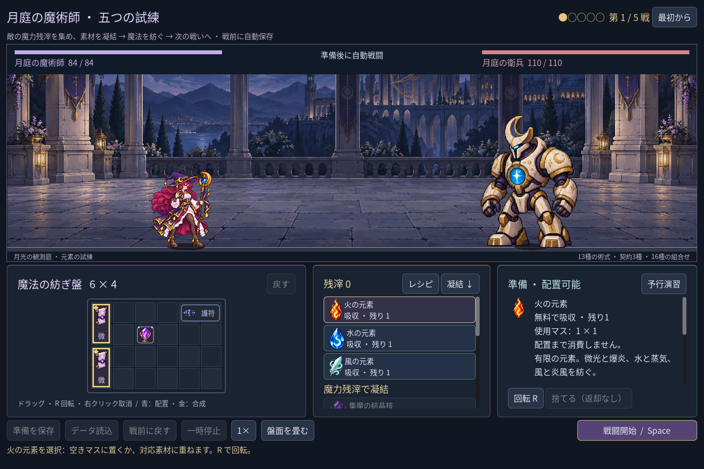
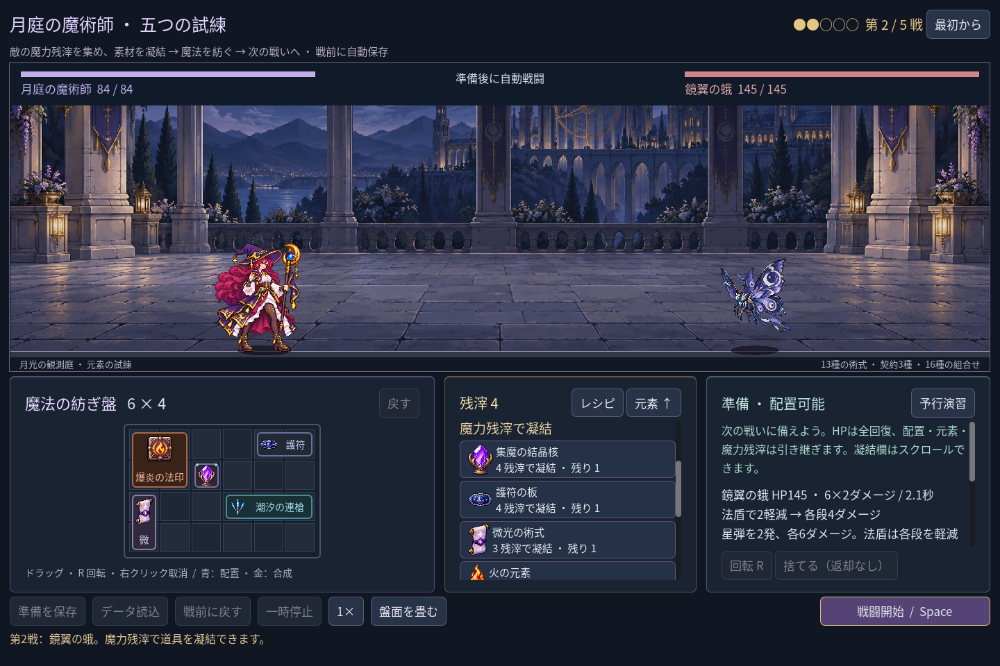
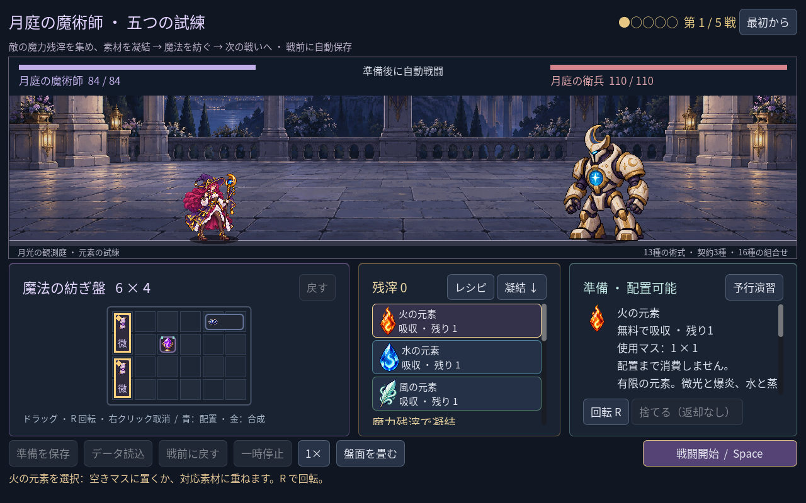
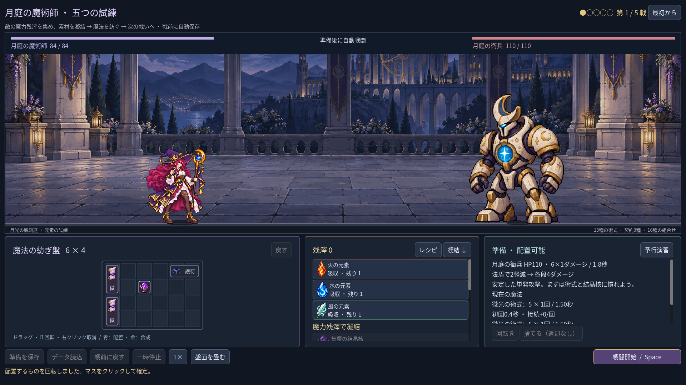

# 2026-11-10：準備画面の情報整理

## 変更

戦闘舞台を広く使う構成は保ちつつ、準備中の三つの領域を整理した。盤面は紫、素材と残滓は金、状況と詳細は青緑の見出しと枠にして、同じ暗色の中でも役割を見分けやすくした。火・水・風のカードにはそれぞれの色を使い、選択中の素材は金枠で示す。画面上部には五戦の現在位置を丸印と戦数で表示する。

素材欄の「凝結 ↓」は購入できる素材一覧の見出しまで移動し、同じ場所の「元素 ↑」で無料元素の先頭に戻る。購入や素材の選択を自動では行わない。従来どおりスクロールも使える。

最初の小窓確認では 1280×800 で風のカードの下端が隠れた。カードの上下余白と間隔を調整し、火・水・風の三枚が全体表示されるようにした。詳細欄と凝結一覧は内容が長い場合、引き続きスクロールする。

## 検証と限界

- `game:mage:campaign:test`：240 checks、0 failures。元素カードの選択表示、凝結と元素の往復、三枚の表示、五戦の進行、プレイヤーセーブ非変更を確認した。
- `game:mage:layout:test` 64、`game:mage:progression:test` 267、`game:mage:discovery:test` 467、campaign rehearsal 45、save 98、undo 38、familiar 76 checks、すべて 0 failures。既存クラスの run 96、battle 143、save 269、UI 115 checks も成功した。
- 1280×800、1440×960、1920×1080 で戦数と再開始、配方・凝結、保存・開始が重ならず、戦闘開始で舞台が広がることを確認。上記の画像は自動操作した実際のゲーム画面。
- Godot MCP の `script-validate` で UI とテストを個別検査し、エラー 0、警告 0。実装途中、型推論できない変数による GDScript 構文エラーを検出し、bool 型を明示して解消した。

今回は視線誘導と操作の往復を改善した。詳細説明の文字量や配方一覧の大きさ、初見で操作できるかは今後の試遊で確認する。
