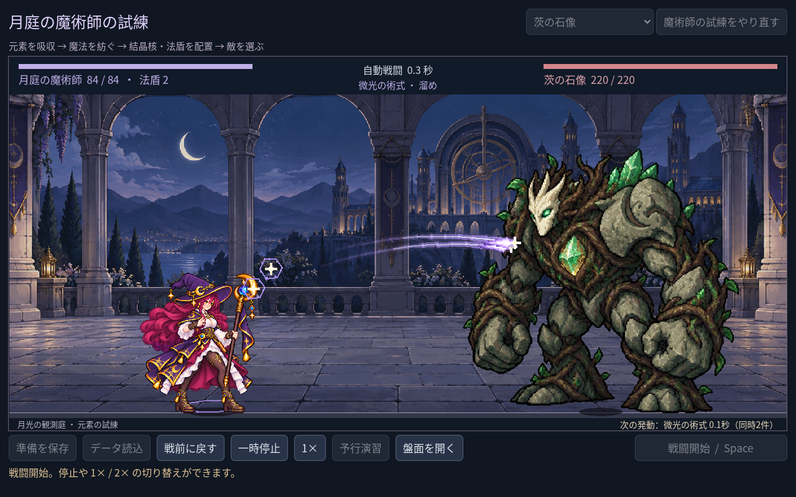
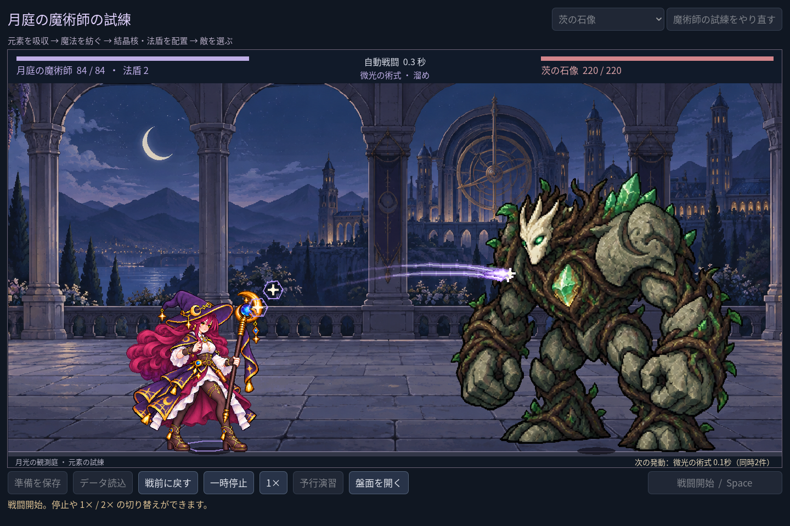

# 2026-11-10：法盾を生命表示に添える

戦闘中は盤面が畳まれるため、装備している法盾値が見えなかった。魔法使いの生命表示に現在の「法盾」を加えた。準備中は現在の盤面、戦闘中と戦後は実際に戦闘開始時に確定した設定を読む。法盾が 0 の場合は表示しない。これは追加 HP ではなく、敵の各ヒットを軽減する値であり、実際の軽減は敵の攻撃値と最低 1 ダメージのルールに従う。受撃時の盾の描画や戦闘計算は変更していない。

## 検証

- `game:mage:layout:test`：90 checks、0 failures。1280×800、1440×960、1920×1080 で準備・戦闘時の法盾 2 と、護符を外した時の表示消去を確認。
- campaign 241、progression 269、VFX 49、cast sync 28、familiar 76、save 98 checks、すべて 0 failures。既存クラスの art 146、grid 194、motion 264、feedback 62、run 96、battle 143、save 269、UI 115 checks も成功。
- Godot MCP の `script-validate` で arena とテストを個別検査し、エラー 0、警告 0。

README の冒頭に残っていた「十四配方」「一種類の使い魔」という古い記述を、現在の十六配方と三種類の契約に更新した。古い単発試練・森林サンプルの起動方法は維持している。
