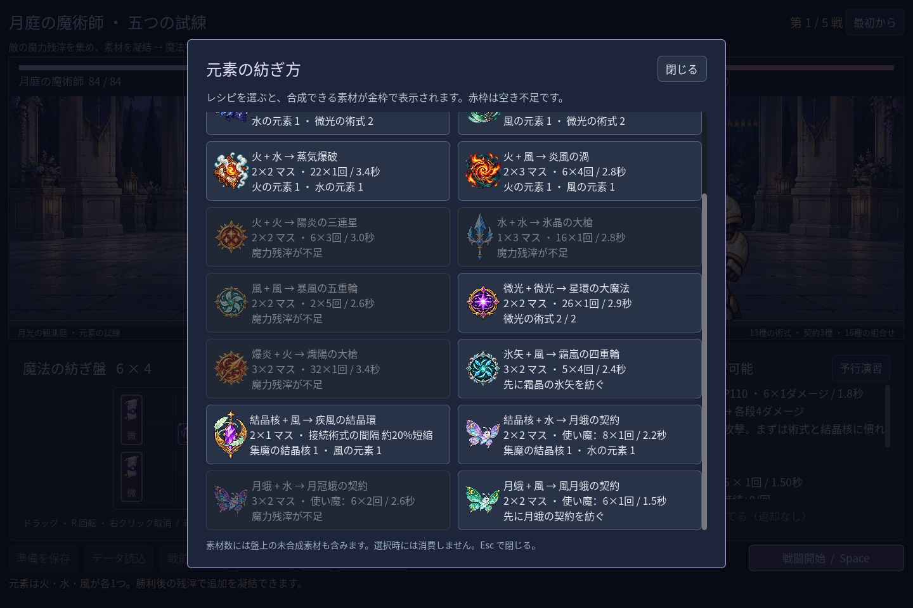
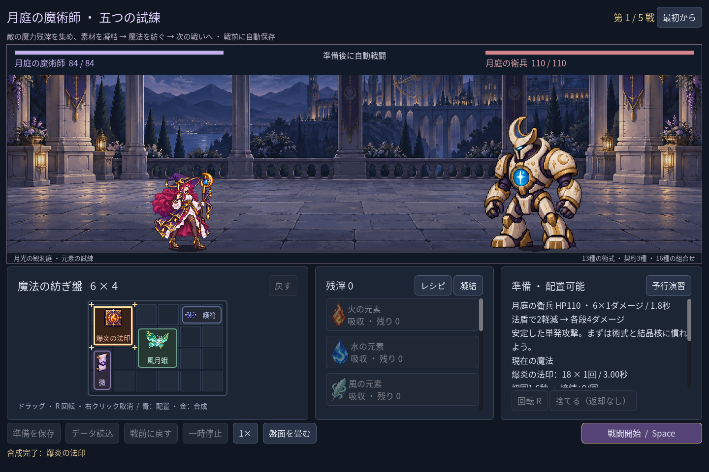
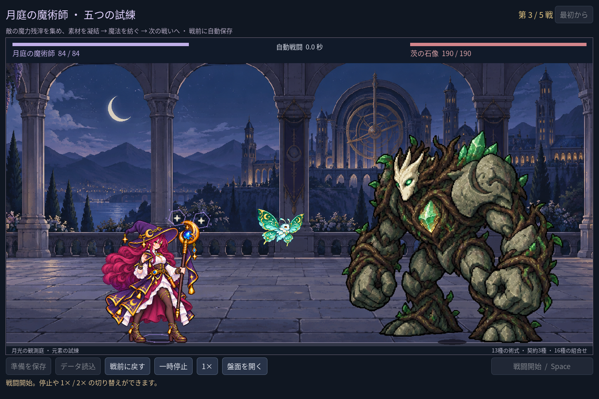

# 2026-11-10：風の使い魔と二つの成長先

## ルール

月蛾の契約に風を重ねる「風月蛾の契約」を追加した。元の月蛾と同じ 2×2 マスで、初回 0.6 秒、以後 1.5 秒ごとに 6×1 ダメージ。水を重ねる月冠蛾は 3×2 マス、初回 1.1 秒、以後 2.6 秒ごとに 6×2 ダメージ。どちらも一体として数え、基本種を含めて合計二体まで。風月蛾は初期の水と風で第一戦から作れるが、風を他の術式や加速支援には使えなくなる。月冠蛾は新遠征では第二の水を戦後の残滓で得る。

## 画像と戦闘

既存の月蛾を参照し、翅を緑・青緑の風模様にした独立画像を生成した。二つの目と触角、四枚の翅、三日月、翅のつながりと欠けを目視確認した。画像は 1536×1024、元 PNG と生成指示・SHA-256 は [manifest](../../assets/art/mage-familiar-wind-v1/manifest.json) に保存。1280×800、1440×960、1920×1080 の実行 fixture で戦闘画面内に収まり、魔法使いや敵に重ならないことを確認した。翅はまだ単一画像で浮遊させている。

## 検証と問題

- `game:mage:progression:test`：267 checks、0 failures。八構成を通常の素材取得・報酬で五戦通した。風月蛾構成の各戦残 HP は 68 / 60 / 48 / 48 / 30、時間は 7.9 / 8.1 / 10.9 / 10.6 / 13.6 秒。固定盤面による結果で、プレイヤーの難易度評価ではない。
- `game:mage:familiar:test`：76 checks、0 failures。二段階の素材予告、風の消費、攻撃時刻、使い魔 UID、遠征セーブ、魔法使いの AnimationPlayer を誤って動かさないことを確認した。途中、遠征の素材台帳を単発試練用セーブで検証して失敗したため、実際の遠征用セーブへ修正した。
- campaign 229、discovery 467、chain guide 29、haste 38、save 98、advanced 103、expansion 152、VFX 49、cast sync 28、layout 64、balance 78、すべて 0 failures。既存クラスの回帰も成功。隔離 PCK の画像 fixture は 8 checks、cold fixture は 1 check、いずれも成功。ゲーム全体の配布 export を保証するものではない。
- Godot MCP は一度編集器と共に停止していた。プロジェクト内 SDK を使う `npm run godot:open` で再起動し、C# build は 0 errors、既存の obsolete API 警告 3 件。再接続後に対象 8 GDScript を個別検査し、エラー 0、警告 0。

使い魔への敵の攻撃、使い魔の独立 HP、翅の逐帧アニメーションは未実装。風と水の分岐の有用性も実プレイで検証が必要。
