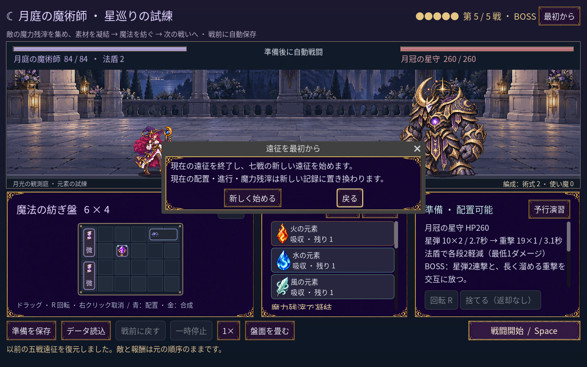

# 2026-11-10：遠征のやり直しを明示する

七戦版を追加した後、ヘッダーの「最初から」は押した瞬間に進行を初期化し、その直後は保存されないことに気づいた。誤操作で現在の準備を失うほか、初期化してすぐ終了すると次回は旧記録が復元される。

遠征では確認ダイアログを表示し、現在の配置・進行・残滓が新しい記録に置き換わることを日本語で説明する。取消を初期フォーカスとし、Escape でも閉じられる。確定時は七戦の初期状態を直ちに保存し、失敗時は保存エラーを表示する。戦闘中のやり直しは受け付けない。単戦と騎士の開始動作は変更していない。

- `npm run game:mage:seven:test`：232 checks、失敗 0。五戦版の別ファイルを実際に読み、確認前・Escape 取消後のファイルハッシュが変わらないこと、確定後に七戦の第1戦として保存・再読込できること、戦闘中に確認画面が開かないことを検証。1280×800 と 1920×1080 でダイアログの画面内収まりも検証した。スクリーンショットは fixture であり、実ユーザーのセーブではない。
- Enter の自動入力では旧データが変わらないことを確認したが、この環境では取消が実行されなかったため、Enter で閉じられるとは主張しない。
- `npm run game:mage:campaign:test`：248 checks、失敗 0。`npm run game:mage:save:test`：98 checks、失敗 0。
- Godot MCP の `script-validate`：`class_lab.gd` 1 ファイル、エラー 0、警告 0、Precise、非打切り。
- 確認画面は既存の月庭パネル・ボタン素材を使用。1440×960 の実画面も記録した。人による操作テストや他 OS での表示は未確認。
