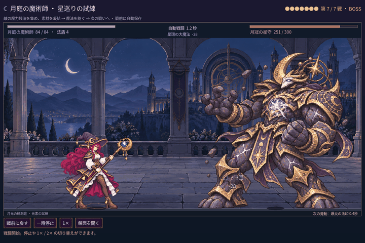

# 2026-11-11：記事の言葉とボス戦の動画

ユーザーの希望に合わせ、記事全体の日本語を読みやすく直した。「盤面」「術式」「構成」などを、道具を並べる場所、魔法、道具の組み合わせのような言葉に言い換えた。ゲーム画面に出る「残滓」は、魔力のかけらという説明と読み方を添えた。今後のプレイヤー向け画面やゲーム用語も、できるだけ簡単な日本語にする方針を要件文書に追記した。既存ゲーム内の全表示は今回変更していない。

記事の大きな人物の設定画像は外し、四つの戦闘用ポーズ画像は表示幅を 420 に指定した。画像自体の元データは変更していない。第四節の GIF は、第一戦から七戦目まで通常の材料取得と勝利を重ねてたどり着いた、最後のボス戦に差し替えた。

撮影ではゲームの保存を無効にした独立の fixture を使い、各戦の勝利と七戦目の敵 ID を確認した。戦闘を 0.1 秒ずつ進めて 45 枚を保存し、1440×960 の画像を 720×480 に縮小、100ms 間隔の GIF にした。これは実時間の連続録画ではない。撮影スクリプトはローカルの `.tools` に置いたため、リポジトリーには含めていない。

ゲームの実行結果は `Boss capture: 45 frames at 0.1 seconds, stage 7, enemy extended_moon_crowned, saves disabled`、終了コード 0。複数のフレームを目視し、ボス、魔法使い、戦闘と日本語 UI を確認した。記事に含まれる Markdown と HTML の画像 5 件すべてについて、参照先が存在することを確認した。元ゲームへのリンクと開発ログのリンク文は再追加していない。ゲームのコードとルールは変更していない。
