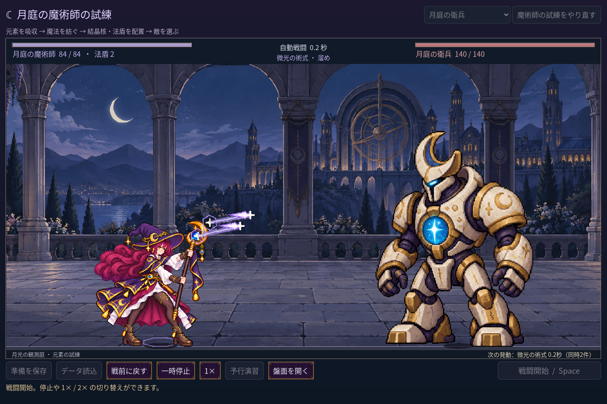

# 2026-11-11：同時発動時の動作選択を安定化

複数の術式が同時刻に発動する場合、一人の法師が全術式それぞれの身体動作を同時に演じることはできない。既存の処理は最も近い発動候補を AnimationPlayer に渡すが、完全に同時刻の候補間には明示的な順序がなく、入力順の違いで選ぶ動作が変わる可能性があった。

予告候補は残り時間を最優先し、完全に同じ時刻では敵の予告を先に、味方の術式はソース ID 順に並べる。表示上限の六件を超える場合でも敵の予告を残す。AnimationPlayer は味方の中で最初の候補を使用し、順序が入れ替わっても同じ動作を選ぶ。これは表示だけの順序で、実際の発動やダメージを間引かない。時刻がわずかに異なる場合は早いものが優先されるため、近接する別時刻の動作切替や四姿勢自体の不連続さは残る。

- `npm run game:mage:cast-sync:test`：29 checks、失敗 0。異なる二術式を同時刻で逆順に渡しても、実際の AnimationPlayer が同じ振り動作を選ぶことを確認。実戦 fixture は同種二術式の同時発動、停止、倍速、回復、独立戦闘結果との一致を確認。
- `npm run game:mage:vfx:test`：50 checks、失敗 0。同時に八つの味方候補と敵候補がある場合も順序と六件の表示上限が安定し、敵の予告が残ることを確認。
- `npm run game:mage:seven:test`：234 checks、失敗 0。三構成の七戦の実際の戦闘結果を独立モデルと比較。
- Godot MCP `script-validate`：変更した演出とテストの 3 ファイルともエラー 0、警告 0、Precise、非打切り。

スクリーンショットは二つの同種術式の実画面であり、異種術式の組み合わせは AnimationPlayer の直接テストで確認した。実際のプレイヤーによる動作の自然さの評価は未実施。
