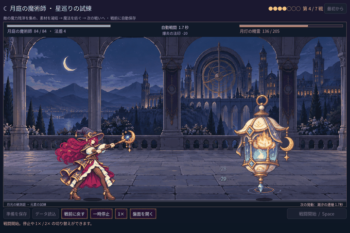
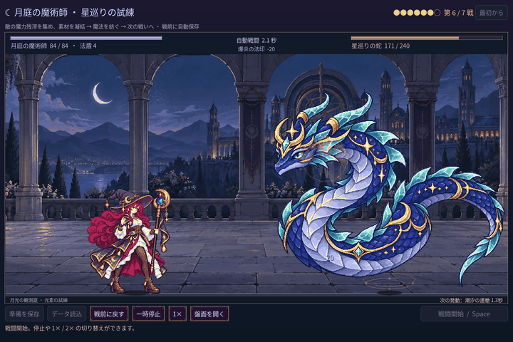

# 2026-11-11：月灯と星巡りの蛇に攻撃の予兆を追加

七戦の新しい敵は投射物こそ異なるものの、発射前は共通の小さな魔法陣に近く、どの敵が攻撃するか伝わりにくかった。両者の元画像は一枚絵であるため、身体や口の新規フレームを作ったように見せず、まず既存画像を保った演出を追加する。

月灯の精霊には、発光部の周囲を巡る月弧と淡い青緑色の足元の輪を追加。星巡りの蛇には、顔の近くを巡る結晶片と金色の弧、足元に四つの印を追加した。飛行中も月弧と金の弧で区別する。いずれも既存の攻撃予告時刻から描画され、ダメージ・弾数・当たり判定・報酬は変更しない。

両 GIF は実際の七戦ルートを自動操作し、ゲーム画面を 0.05 秒ずつ進めた PNG から作成した。元の 1440×960 を 720×480 に縮小し、50ms 間隔で表示している。静止画でも [月灯](screenshots/2026-11-11-enemy-charge-v1/moon-lantern-gather.png) と [蛇](screenshots/2026-11-11-enemy-charge-v1/astral-serpent-gather.png) の蓄力を確認できる。

- 通常の `npm run game:mage:seven:test`：234 checks、失敗 0。二体の予兆・飛行・実際の二段命中を確認し、三つの構築の戦闘結果を独立した戦闘モデルと比較。
- PowerShell で `$env:MAGE_CAPTURE_SEQUENCE='1'` を付けた同テスト：282 checks、失敗 0。各敵の連続 24 枚を追加保存。環境変数を指定しない通常回帰では連続画像を保存しない。
- `npm run game:mage:vfx:test`：49 checks、失敗 0。既存演出と戦闘時計、停止、倍速、命中時刻を確認。`npm run game:mage:cast-sync:test`：28 checks、失敗 0。
- Godot MCP `script-validate`：変更した演出とテストの 2 ファイルともエラー 0、警告 0、Precise、非打切り。

画面確認では予兆は元の絵の細部に重なるため比較的控えめで、実際のプレイヤーによる視認性の確認が必要。両敵の身体は引き続き一枚絵の浮遊・移動であり、羽や口のアニメーションは追加していない。魔法使いの四姿勢の中間動作と複数同時発動時の視線誘導も今後の課題。
