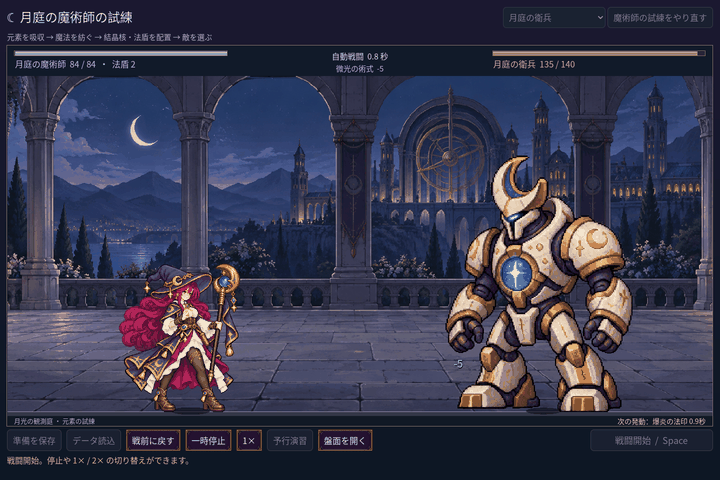

# 2026-11-11：法師の施法に重心の動きを追加

中間姿勢の生成が既存人物と一致せず不採用になった後も、既存素材で改善できる部分があった。三つの AnimationPlayer 動作 `cast`・`swing`・`gesture` に連続補間する傾きのトラックを追加し、準備でわずかに身を引き、放出時に前へ、収束時に戻るようにした。最大振幅は約 0.035 ラジアン（約 2 度）。三動作で強さを分け、元の四姿勢の切り替え時刻、素材と戦闘時刻は変更しない。

描画担当の Sprite2D と被弾アニメーションの間に独立した回転ノードを設け、地面の基準点を中心に回す。スプライトのスケールは変えず、被弾の水平移動と合成する。発射位置には同じ回転と被弾移動を適用し、法杖と弾道の始点が離れないようにした。足元の基準点は固定されるが、画像全体の回転で両足それぞれの画素が完全に固定されるわけではない。

GIF は 1440×960 の Godot 画面を 720×480 に縮小し、50ms 間隔で表示した。素材・構図を自動で用意した fixture であり、プレイヤーのリアルタイム操作ではない。[発射の静止画](screenshots/2026-11-11-mage-lean-v1/release.png)。連続フレームを目視し、両手と杖、足元と法杖からの発射を確認した。

- `npm run game:mage:cast-sync:test`：34 checks、失敗 0。傾き曲線、地面の基準点とスケール、実際の Sprite2D 変換後の法杖位置と発射点の一致、停止・倍速・着弾・戦闘結果を検証。`MAGE_CAPTURE_MOTION=1` では実際の爆炎合成と25枚の連続撮影を追加し、36 checks、失敗 0。
- `npm run game:mage:motion-v2:test`：187 checks、失敗 0。`npm run game:mage:hit:test`：27 checks、失敗 0。`npm run game:mage:vfx:test`：50 checks、失敗 0。
- `npm run game:mage:seven:test`：234 checks、失敗 0。`npm run game:mage:layout:test`：90 checks、失敗 0。`npm run game:classes:test`：Run 96、Battle 143、Save 269、UI 115、すべて失敗 0。異常セーブのテスト中に Godot の指数表記警告が出る。
- `npm run game:classes:art:test`：静止画像 146、盤面 194、動作 264、被弾 62、すべて失敗 0。ソース画像を直接読むテストで Godot のエクスポート警告が出る。
- Godot MCP `script-execute` で対象シーンを読み、cast / swing / gesture がそれぞれ pose と lean の 2 トラックを持つことを確認。`script-validate` で変更した 3 つの GDScript はエラー 0・警告 0、Precise、非打切り。

傾きは一枚絵全体に作用する補助動作であり、腕や髪を別々に動かす新しい中間フレームではない。元の姿勢間の飛びや回転時のピクセルの見え方は残り、人による実機の評価が必要。
