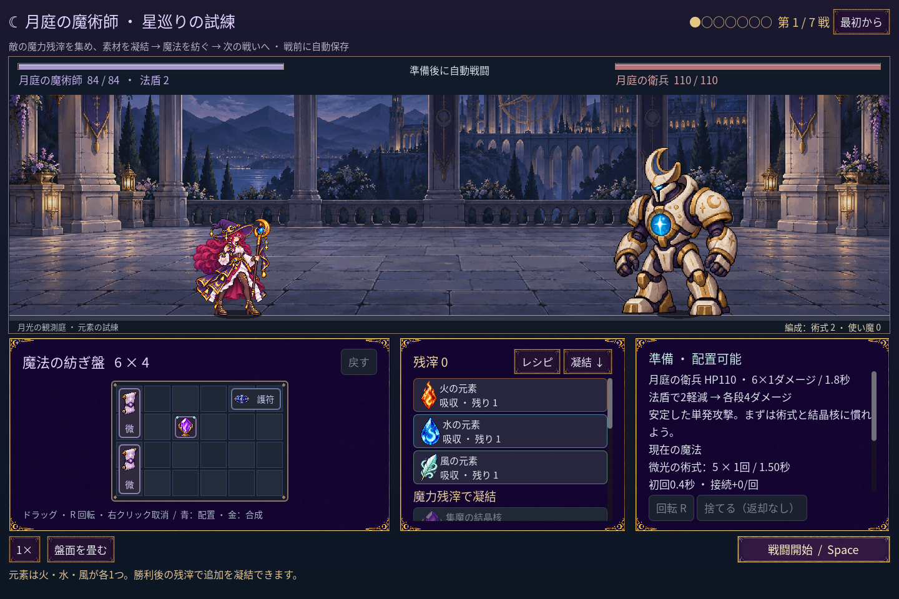
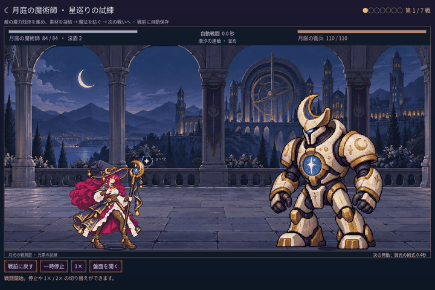

# 2026-11-11：プレイヤー向け画面と短い制作記事

ユーザーから、振り杖は中間姿勢を挟むより直接発射姿勢に切り替える方がよいとの意見を受けた。`swing` の斜め姿勢を振り上げと発射の間から外し、AnimationPlayer を `0 → 1 → 2 → 3 → 0` に戻した。前回撤回した全身の傾きは復活させていない。発射・実ダメージの時刻は変更しない。

遠征の画面から開発向けの予行演習と通常時の手動保存・読込を隠した。遠征は自動保存のままにし、保存に失敗した時は「保存を再試行」を表示する。最終戦以外の勝利後も、再試行では次の戦いの準備と報酬を保存し、表示中の勝利画面は進めない。戦闘中に使えない開始・最初からのボタンと、準備中に使えない停止・戦前に戻すボタンも隠した。独立した単戦や職業実験は維持し、予行演習は開発テストで明示的に有効にできる。

戦闘結果と配置プレビューでは内部 ID を表示せず、同名の術式を盤面の列・行で区別する。術式の実際の ID、戦闘集計と保存形式は変更していない。

GIF は新しい七戦の第一戦を実際に 0.05 秒ずつ進めた撮影で、1440×960 を 720×480 に縮小した。実時間の録画ではない。

長い時系列のブログ下書きは、きっかけ、Codex・Godot MCP・画像生成、制作手順、試行錯誤と感想を一つの記事にまとめ直した。ユーザー指定の[AvaKansaiの技術記事](https://note.com/avakansai/n/n1c5c8016b547)などを参考に、自然な説明と具体的な工程を意識した。Claude Fable 5.2 のゲーム事例は[報告記事](https://cellcog.ai/blog/fable-5-2-one-shot-game-cost/)に基づく他者の事例として紹介し、本ゲームで使ったとは書いていない。元の制作過程は各開発ログと Git 履歴に残る。

- `npm run game:mage:seven:test`：240 checks、失敗 0。`MAGE_CAPTURE_PLAYER_UI=1` で実画面25枚を追加収録した場合は 265 checks、失敗 0。
- `npm run game:mage:save:test`：100 checks、失敗 0。準備・途中勝利・最終勝利それぞれの保存失敗と再試行を確認。
- `npm run game:mage:cast-sync:test`：34 checks、失敗 0。`MAGE_CAPTURE_MOTION=1` の撮影付きは 37 checks、失敗 0。直接切替、停止・倍速と発射時刻を確認。
- `npm run game:mage:campaign:test`：248、`game:mage:progression:test`：269、`game:mage:layout:test`：90、`game:mage:undo:test`：39、`game:mage:familiar:test`：76、`game:mage:haste:test`：41、`game:mage:campaign:rehearsal:test`：45 checks、いずれも失敗 0。
- Godot MCP `script-execute` で `swing` が姿勢トラック 1 本・発射キー 0.40 秒であることを確認。変更した GDScript 9 本は `script-validate` でエラー 0・警告 0、Precise、非打切り。
- ブログの画像埋め込みは日本語 UI の実画面 2 点で、リンク先の存在を確認した。文章は公開前の下書きであり、note への投稿は行っていない。
