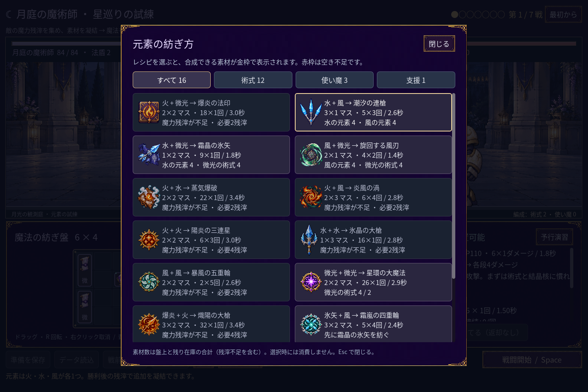

# 2026-11-11：レシピに素材の在庫と必要な残滓を表示

七戦の準備中、凝結素材が在庫に残っていても、残滓が足りない場合は「素材不足」と数えられていた。レシピを見ても必要な残滓が分からず、次の報酬を何に使うか判断しにくかった。

在庫数と支払い可能かを別々に計算し、残滓不足と在庫不足を区別した。素材数は盤上の未合成素材と残り在庫の合計で、残滓不足の在庫も含む。既存の素材を優先し、複数の購入が必要な場合は必要個数に応じて費用を合算する。完成に必要な在庫が揃っている場合、直接合成は必要額、前提を経由するレシピは二段階の合計額を表示する。在庫不足で完成できないときは、不完全な購入額を完成価格として表示しない。選択時に素材を消費しない点は変わらない。

利用できないレシピも理由が読めるよう、暗い文字とアイコンのコントラストを調整した。費用を表示する変更であり、敵・報酬・アイテム性能は変更していない。

- `npm run game:mage:chain-guide:test`：37 checks、失敗 0。在庫があって予算がない場合、予算ぴったり、二段階の合計、在庫不足、選択時に状態が変わらないことを検証。
- `npm run game:mage:discovery:test`：497 checks、失敗 0。配方選択・配置と実画面入力を検証。
- `npm run game:mage:seven:test`：232 checks、失敗 0。三つの固定構成と五戦の旧記録を検証。
- `npm run game:mage:save:test`：98 checks、失敗 0。`npm run game:mage:layout:test`：90 checks、失敗 0。
- プロジェクト内 SDK で Godot .NET エディターを起動し、MCP `script-validate` で変更した 3 本を確認：エラー 0、警告 0、Precise、非打切り。エディタープラグインの C# ビルドには既存の非推奨 API 警告が 3 件ある。

レシピの提示が実際のプレイヤーに十分かは未検証。人による試遊と、戦闘における複数の構築の強さの評価は今後も必要。
