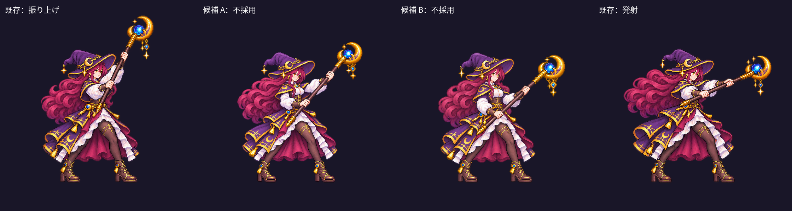

# 2026-11-11：振り杖の中間姿勢を検討し、不採用

魔法使いの振り杖は四つの離散姿勢であり、振り上げから前方への切り替えに中間姿勢がない。既存の `assets/art/mage-motion-v2/characters/mage-swing.png` を参照し、透明背景の中間姿勢を二案生成した。A は振り上げと発射の中間角度、B は顔・髪・衣装・足の位置をより強く固定するよう指定した。

各画像を目視すると、両案とも二つの手で連続した杖を握り、二本の足と杖先は画面内に収まる。一方、既存の二姿勢と並べると、顔の大きさと形、帽子の傾き、髪の束や位置、上半身の幅、腰の装飾に違いがある。A と B の杖の角度は中間に近いが、身体まで再描画されているため、数値上の脚点だけを合わせても切り替え時に跳ねる可能性が高い。比較は概算の位置合わせであり、実際のゲーム画面やアニメーション再生ではない。

二案とも採用せず、ゲームの画像・AnimationPlayer・戦闘ルールには接続していない。元候補 [A](../concepts/2026-11-11-swing-candidates/candidate-a.png) と [B](../concepts/2026-11-11-swing-candidates/candidate-b.png) は概念画像として保管した。今後は元の頭・髪・衣装・脚を固定できる分層素材か手描き修正を検討し、尺・脚点・杖の発射位置を実機で検証する必要がある。今回は実装変更がないため、新しいゲームテストは行っていない。
