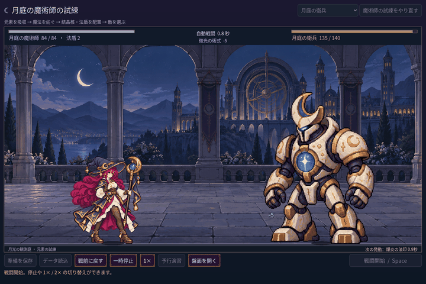

# 2026-11-11：全身の傾きを撤回し、杖の中間姿勢を使う

> 追記：ユーザーのフィードバックにより、この中間姿勢の挿入も撤回済み。現在の動作は[後続記録](2026-11-11-player-ui.ja.md)を参照。

前回追加した施法時の全身の重心移動は、ユーザーから動きが良くないとのフィードバックを受けたため撤回した。回転用ノード、AnimationPlayer の傾きトラック、発射点の回転変換を外し、既存の被弾移動は残す。前回の記録と動画は比較用の履歴であり、現在の動作ではない。

振り杖の既存四姿勢を改めて見ると、元々の収束姿勢は杖が斜め上を向いていた。この姿勢を振り上げと発射の間にも短く使用し、AnimationPlayer の `swing` を `0 → 1 → 3 → 2 → 3 → 0` に変更。斜めの姿勢はタイムラインの 0.29 秒から、従来の発射姿勢は 0.40 秒から表示する。新しい画像を接ぎ足さず、従来の身体比率と脚点補正を利用する。別の生成候補も確認したが、既存の斜め姿勢と近く、元の他の姿勢も描き直されていたため採用していない。

GIF は実際の単戦 fixture で火と微光を合成し、1440×960 の画面を 0.05 秒ずつ進めて収録、720×480 に縮小した。画面では斜め姿勢、放出姿勢と法杖先からの弾道を確認した。[斜め姿勢の静止画](screenshots/2026-11-11-swing-intermediate-v1/diagonal.png)。

- `npm run game:mage:cast-sync:test`：32 checks、失敗 0。`MAGE_CAPTURE_MOTION=1` の撮影付きは 35 checks、失敗 0。斜め姿勢が蓄力中、放出姿勢が弾道飛行中に表示されること、全身回転がなく身体の正規化後の高さが変わらないこと、停止・倍速と独立戦闘結果を確認。
- `npm run game:mage:motion-v2:test`：187 checks、失敗 0。`npm run game:mage:hit:test`：27 checks、失敗 0。`npm run game:mage:vfx:test`：50 checks、失敗 0。`npm run game:mage:seven:test`：234 checks、失敗 0。
- `npm run game:classes:test`：Run 96、Battle 143、Save 269、UI 115、すべて失敗 0。異常セーブ試験中に Godot の指数表記警告が出る。
- Godot MCP の `script-execute` で `swing` の実際のキー時刻と値を確認。関連する GDScript 3 本の `script-validate` はエラー 0・警告 0、Precise、非打切り。

新しい手描きの中間絵ではなく、元の収束姿勢を再利用しているため、姿勢間の絵の差は残る。操作感や自然さは引き続き実際のプレイヤーによる確認が必要。
