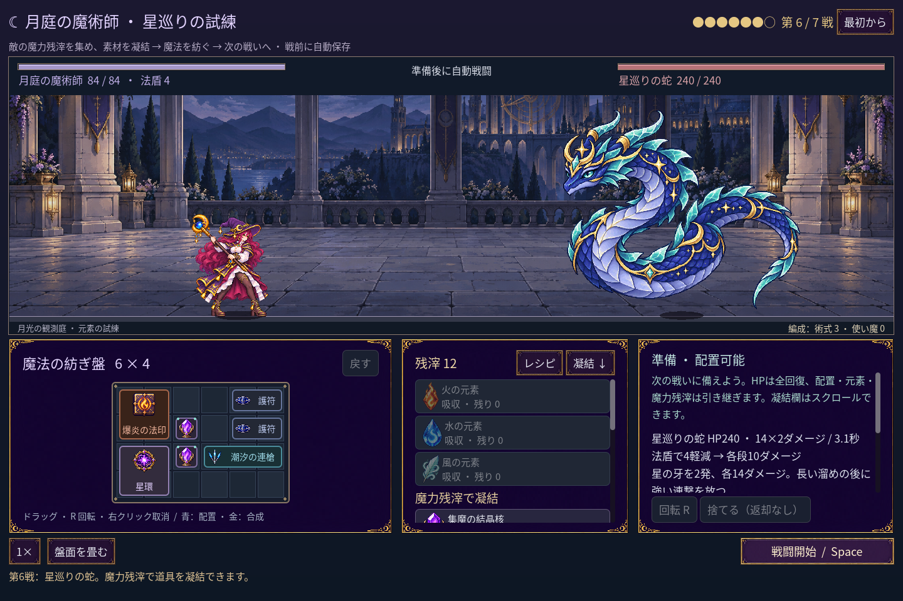
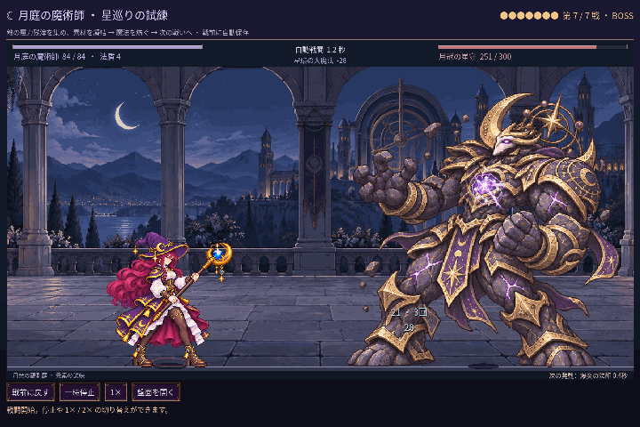

# 2026-11-12：現在の動きでブログ画像を撮り直す

ユーザーの希望に合わせ、[ブログ](../blog/emberpack-making-of.ja.md)のレシピ画面、第六戦の準備画面、最後のボス戦 GIF を現在の杖の四姿勢を使うゲーム画面に差し替えた。冒頭の準備画面はすでに現在の姿勢で撮影したものだったので、そのまま使っている。以前の記録画像は上書きせず、新しい[画像フォルダー](screenshots/2026-11-12-blog-current-mage-v1/)に保存した。

撮影スクリプトは [capture_blog_mage.gd](../../scripts/capture_blog_mage.gd)。保存を無効にした独立の遠征で、通常の材料取得と配置を行い、第1〜6戦に勝利してボスへ進んだ。第六戦は敵 ID `astral_serpent`、第七戦は `extended_moon_crowned` を確認した。ゲームの実行を0.1秒ずつ進めてボス戦45フレームを取得し、1440×960から720×480へ縮小して4.5秒の無音 GIF にした。実時間の録画ではなく、自動操作による撮影である。

`node scripts/godot.mjs render-script res://scripts/capture_blog_mage.gd` は終了コード0。四姿勢すべてが取得フレームに含まれた。レシピ画面、第六戦、GIFの複数フレームを目視し、人物、ボス、魔法の表示と日本語の画面を確認した。GIF は45フレーム、720×480、合計4500ms。画像のハッシュは [manifest.json](screenshots/2026-11-12-blog-current-mage-v1/manifest.json) に記録した。小さな文字は GIF を縮小したため読みづらい。

今回の `npm run godot:status` では Godot エディターは起動中だったが、ローカル MCP サーバーへの接続は拒否された。エディターは再起動せず、撮影はプロジェクトの Godot を別途起動して行った。ゲームのルールやプレイヤーの保存データは変更していない。
