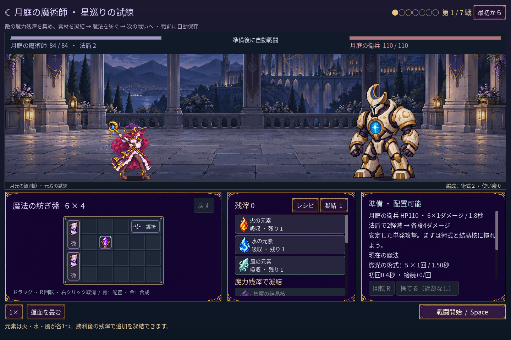
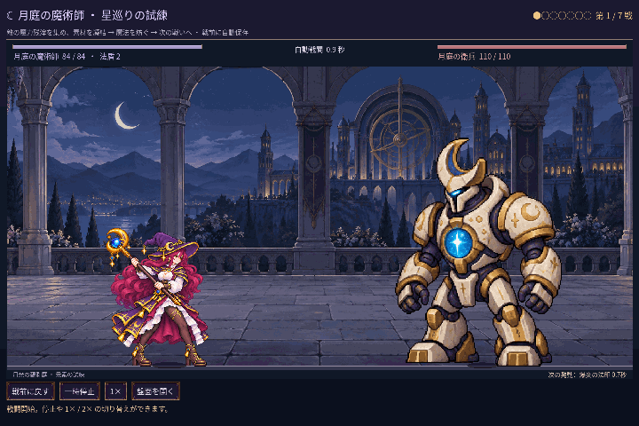

# 2026-11-12：魔法使いの姿勢を四枚に揃える

ユーザーから、ブログに載せた杖を振る四姿勢をゲーム全体で使いたいとの要望があった。従来は火系などに `mage-swing`、水・風系に `mage-gesture`、基本術式や待機に `mage-cast` を使っていたため、場面によって別の人物画像に切り替わっていた。

魔法使いの遠征と一戦版では、待機に `mage-swing` の最初の姿勢を使い、火・水・風・基本術式などの発動も同じ四姿勢の AnimationPlayer に揃えた。準備、予告、発射、命中後の戻りまで画像を切り替えない。旧二職業実験の従来の姿勢は維持する。発射時刻、実際のダメージ、道具の待ち時間、保存形式は変更していない。同時に複数の術式が発動しても、一つの姿勢で各術式の戦闘結果を維持する。

GIF は通常の操作で火の術式を作った遠征の戦闘を26枚、0.05秒ずつ進めて取得し、1440×960 から 720×480 へ縮小した無音1.3秒の映像。実時間の録画ではない。保存は無効にした fixture を使い、水の術式も[別の実行画像](screenshots/2026-11-12-mage-four-pose-v1/water-impact.png)で確認した。[画像の一覧とハッシュ](screenshots/2026-11-12-mage-four-pose-v1/manifest.json)を保存している。

元画像の四姿勢を目視し、両腕、脚、顔、杖の頭と柄、画像の端を確認した。実機画像でも待機、杖を上げた姿勢、発射、戻りと水の命中を確認し、GIF の複数フレームを展開して確認した。足元と帽子から測る身体の高さは自動検査で揃っているが、四枚の離散姿勢の切り替えが常に自然に見えることまで保証するものではなく、手や体の細部には引き続き目視評価が必要。

## 検証

- `game:mage:motion-v2:test`：233 checks、失敗0。待機、火と水の四姿勢、三画面寸法、足元、身体の高さ、発射点、独立した戦闘結果との一致を確認。基本術式と旧二職業実験の姿勢選択も確認した。
- `game:mage:cast-sync:test`：35 checks、失敗0。予告、発射境界、同時発動、停止、倍速、命中と戦闘結果を確認。旧姿勢の起手時刻を前提としていた1項目は、今回の姿勢の開始と振り上げに分けて確認した。
- `game:mage:legs:test`：17、`game:mage:layout:test`：90、`game:mage:vfx:test`：50、`game:mage:campaign:test`：248 checks、いずれも失敗0。旧画像のパスを前提としていた姿勢検査は新しい使用画像を確認するよう変更した。
- `game:classes:art:test`：146 + 194 + 264 + 62 = 666 checks、失敗0。旧素材の画像をテストで直接読む処理について Godot の書き出し互換性警告は残る。配布版は今回検証していない。
- `npm run godot:status` では編集済みプロジェクトのエディターは起動中だったが、MCP サーバーは接続を拒否した。エディターを閉じたり再起動したりせず、今回の検証はプロジェクト内の Godot で実行した。MCP 接続や MCP による編集が成功したとは記録しない。

README とブログの準備画面を今回の画像に更新し、以前の姿勢を使った画像とボス戦 GIF はその旨を明記して残した。
