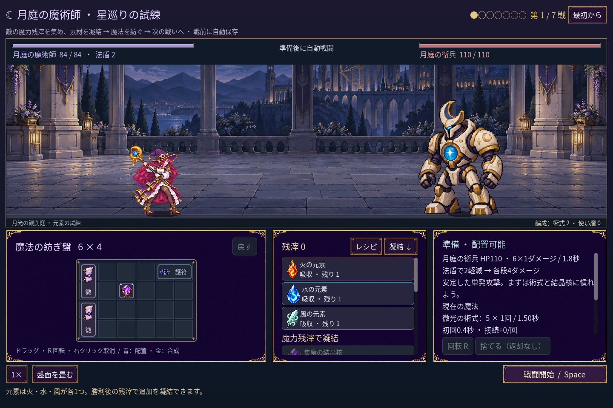
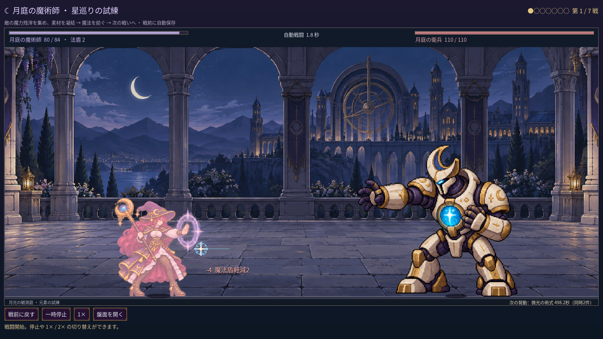
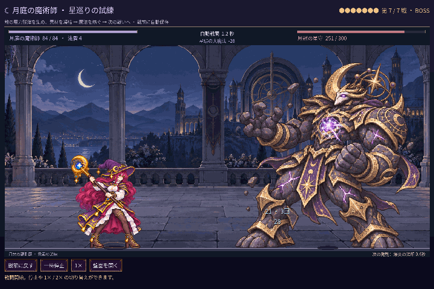

# 2026-11-12：魔法使いの七つの姿勢

ユーザーの希望で、待機一種、攻撃三種、防御三種を同じ人物として画像生成した。最初は比較用の画像として作ったが、ユーザーが「この画像を直接使いたい」と選択したため、七姿勢と描き込まれた光をそのままゲームに採用した。[元画像とハッシュ](../../assets/art/mage-pose-set-v1/manifest.json)を保存している。

画像を暗い背景と明るい背景に重ねて目視し、顔、髪、服、二本の腕と脚、杖の持ち方と先端を確認した。各姿勢の周囲を測り、隣の姿勢や画像端と透明領域が重ならないことを確認した。身体の高さと足元を揃えて実ゲームでも七姿勢を確認したが、画像生成による顔や杖の細部の違いと、姿勢の急な切り替えは残る。

AnimationPlayer の発射時刻に合わせて三つの攻撃姿勢から一つを選ぶ。一つの施法の途中では姿勢を選び直さず、同時発動も一つの動きにまとめる。減傷を伴う敵の攻撃を受け、かつ施法中でない場合は三つの防御姿勢から一つを選ぶ。実際には軽減していない攻撃で盾を見せず、施法中は攻撃姿勢と動的な盾を優先する。演出専用の乱数を使うため、戦闘の数値と結果には影響しない。

杖の光は絵に描き込まれているので半透明を維持し、選ばれた杖の先から既存の飛行・命中効果を出す。防御姿勢中は、絵の盾と同じ位置に大きな動的盾を重ねない。光は全属性で青紫色のままで、炎の魔法でも発射部分を個別に赤くすることはできない。これは今後、人物と効果を別レイヤーにする場合の課題である。

ボス戦は保存を無効にし、通常の取得・配置と勝利を重ねて第七戦へ進んだ。45フレームを0.1秒刻みで取得し、1440×960から720×480に縮小した無音4.5秒 GIF。実時間の録画ではない。今回の撮影では待機、三つの攻撃、防御一種が現れた。ブログと README の現在の画像を更新し、古い記録画像は残した。[画像ハッシュ](screenshots/2026-11-12-mage-seven-poses-v1/manifest.json)

## 検証

- `game:mage:pose-set:test`：111 checks、失敗0。七領域、乱数の三種到達、施法中の選択固定、被弾との優先順位、実際の減傷、三画面サイズ、独立した戦闘結果を確認。
- `game:mage:motion-v2:test`：233、`game:mage:cast-sync:test`：35、`game:mage:hit:test`：27、`game:mage:legs:test`：17、`game:mage:layout:test`：90、`game:mage:vfx:test`：50 checks、いずれも失敗0。
- `MAGE_CAPTURE_MOTION=1` を付けた `game:mage:cast-sync:test`：38 checks、失敗0。実戦のフレーム保存を含む追加確認。
- `game:mage:campaign:test`：248、`game:mage:seven:test`：240 checks、失敗0。七戦版は複数の組み合わせで確認したが、すべての構成の難易度を保証するものではない。
- `game:classes:art:test`：146 + 194 + 264 + 62 checks、失敗0。旧画像をテストで直接読む箇所の Godot 書き出し互換警告は残る。
- `game:classes:image-pack:test`：コールド画像1、パック画像13 checks、失敗0。新しい画像も元 PNG がないパック内から読み込めた。ゲーム全体の書き出しは検証していない。
- `npm run godot:status` ではエディターは起動中だったが、MCP サーバーへの接続は拒否された。エディターを再起動せず、プロジェクト内の Godot で検証した。
