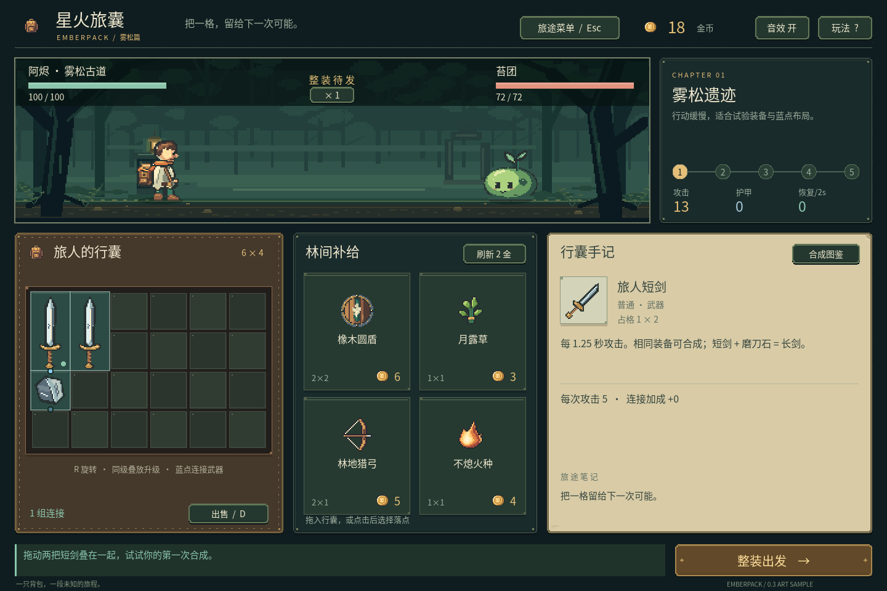
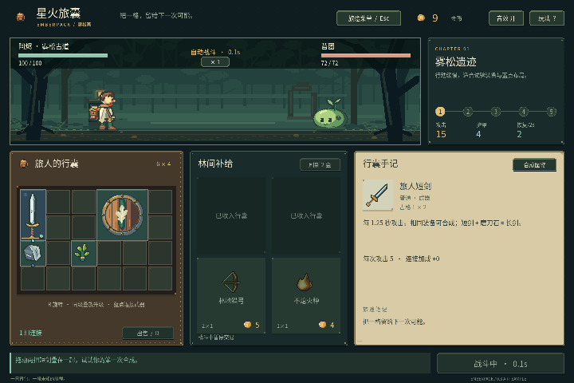

# v0.3 美術試作：M1-A/B の成果

日付：2026-10-22（JST）。[開発計画](development-plan.md)の M1-A/B にあたる実行可能な試作を作り、v0.2 のルールと保存形式を維持しました。M1-C や v0.3 全体の完成を意味するものではありません。

## 実装したもの

- 実際の出力サイズに合わせた画面。`EmberLayout` が描画と入力の範囲を共有し、標準は 1440×960、最小は 1280×800。大きなウィンドウでは3倍のピクセル格子を使い、画面全体の0.9倍縮小をやめた。
- バッグ、店、手記、報酬、メニューを別の表示部品に分割。メイン画面は入力、ルール、保存、戦闘イベントの連携を担当。
- `EmberTheme` で色、革の縫い目、紙、銅の留め具、ボタンの見せ方を統一。画面全体に重なる表示を使い、戦闘中の取引を無効化。
- 主人公と苔団は各64×64の元画像を使用し、それぞれ待機4、攻撃4、受撃2、退場4フレーム。足元を固定し、縦横比を保ち、一時停止時は動きと効果を停止。
- 短剣32×64、盾64×64、砥石32×32のバッグ用画像と各32×32の小アイコン。回転は画像全体に適用し、正方形画像の引き伸ばしを解消。
- コードで作る森林は512×144、地面は y=126。キャラクターと同じピクセル倍率を使い、中間のウィンドウ幅では静止した端の背景を延長して範囲外を読まない。
- 剣、矢、回復、反射、合成の表示例。攻撃元の装備の光は実際の戦闘イベントと連動し、表示がダメージを決めることはない。炎の斬撃に追加の燃焼はない。
- コードから作った9枚の PNG と、出典、寸法、基準点、動き、ハッシュの一覧。キャラクター画像の比較表は素材プレビューであり、ゲーム画面ではない。

## 範囲と制限

| ファイル | 役割 |
| --- | --- |
| `scripts/ui/ember_layout.gd` | 出力サイズから盤面、ボタン、パネル、報酬、画面全体の遮罩を計算し、描画と入力で共有 |
| `scripts/ui/ember_theme.gd` | テーマの色、革・紙・暗いパネル、ボタンの見た目 |
| `scripts/ui/backpack_view.gd`、`market_view.gd`、`journal_view.gd` | バッグ、店、道具と配方の手記を読み取り専用で描画 |
| `scripts/ui/overlay_view.gd` | 報酬、一時停止、ヘルプ、結果の表示 |
| `scripts/gameplay/main.gd` | マウス、キー、ルール、保存、戦闘表示の連携。互換テスト用の動的な位置情報も保持 |
| `scripts/visuals/pixel_art_v03.gd`、`scripts/ui/forest_stage.gd` | コードによる素材とキャッシュ。独立した描画データを使い、遠征の乱数を消費しない |

当時の範囲は **12装備・5配方・7祝福・6×4バッグ・五戦**です。`run_state.gd` と `run_save.gd` は変更せず、旧保存の項目と道具 ID を維持しました。

残り9装備は旧正方形アイコンを正しいマス数の透明な画像の中央に置いています。比率は維持しますが、長剣、弓、背の高い薬瓶の専用の輪郭はありません。狼、ゴブリン、樹型の敵は旧静止画で、樹の衛兵とボスは同じ外観です。七つの祝福の専用アイコンも未完成。森林は複数の層を合成した静止画で、実行時の視差はありません。

段階的な説明、装備の詳細、購入・回転・合成前後の能力比較、直前の操作の取り消しは M1-C の範囲です。今回は燃焼、敵の能力、店の出現確率やロックを追加しておらず、複数流派のバランス完成も宣言していません。

## 検証

`npm run game:test` は基本ルール126、保存148、UI 210、美術資産の契約465、合計 **949項目・失敗0**。五つの出力サイズ（1280×800、1440×960、1600×900、1440×1080、1920×1080）で配置、入力、背景、同じ乱数種によるルール結果を確認し、再開時の状態消去と表示の一時停止も検査しました。

実際の OpenGL ウィンドウは 1280×800、1440×960、1920×1080 を確認して画像を保存。準備、戦闘、合成、ドラッグのプレビュー、祝福、メニューを見て、実行ログにスクリプトエラーはありませんでした。すべての Windows DPI、他 OS、タッチ操作、配布版、一定の FPS は検証していません。プラグインと C# は変更していないため、関連しないビルドは再実行していません。

この GIF は Godot Movie Maker で実行した80フレーム、16 FPS、シミュレーション上5秒の記録です。二フレームごとに一枚を取り、720×480 に縮小し、音声はありません。初期資源で可能な購入と合成を行った自動戦闘で、コンセプト画像のアニメーションではありません。素材制作と問題は[開発ログ](devlog/2026-10-22-art-sample.ja.md)に記録しています。

## 次の作業

M1-C で残りの美術を増やし、説明、詳細、能力比較、取り消しを進める予定でした。この版と旧版の実行画像は比較用に残し、同じフォルダーを上書きしません。
