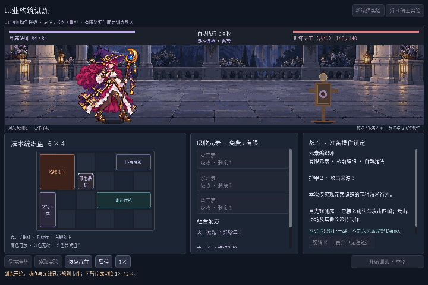
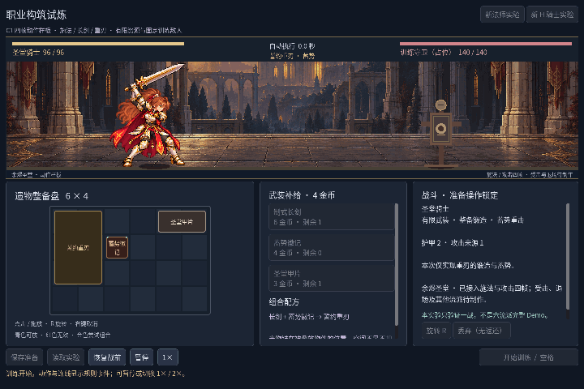

# C1 四帧动作样板 · 2026-10-26

入口仍是 `npm run game:classes`。在[静态接入](iteration-c1-static-art.md)后，新增MA法师施法、KA骑士长剑和双手重刃三组专用动作，每组四帧：静态待机、预备、命中、收势。它们为动作另绘，不是旧人设概念的切片。完整C1及完整RV-04未完成。





[长剑实际运行片段](devlog/screenshots/c1-motion-v1/sword-motion.gif)使用初始长剑，没有购买或锻造重刃。三种配置分别录制。

## 实现行为

- `charge`显示预备帧，保持到实际命中；动画不会提前造成伤害。
- `spell`、`spell_burst`、`spell_multi`、`attack`、`heavy_charge`在真实命中时进入第2帧，显示0.16秒，随后收势，到0.42秒返回静态待机。这些表现时长不决定战斗时序。
- 同来源、同一时刻的多段命中共用一次动作，潮汐仍造成三段真实伤害。一个主角代表并行来源，后来的命中可覆盖先前演技；命中/收势期间的并发预备不打断它。没有为所有来源排队重演。
- 暂停冻结动作和事件提示；1×／2×同时影响规则与表现。新职业、读档、恢复战前、新战开始会清理瞬时表现。最后一击可完成收势，中断的预备不会留在结果画面。
- 准备与空闲按实际配置选择姿态；骑士无攻击武器时仍显示待配标记。长枪规则、物品ID、配方、保存结构和默认森林均未修改。

法师合法编织fixture仍为8.60秒，重刃11.00秒，均140有效伤害；初始长剑fixture为21.35秒、140有效伤害。结算仍来自同一个规则引擎，不包含额外动画时间。

## 源图与修正

内置 **imagegen** 生成/编辑的三张专用图集位于 `assets/art/c1-motion-v1/characters/`，各1122×1402。见[尺寸、alpha、源区和SHA-256](../assets/art/c1-motion-v1/manifest.json)及[提示集](../assets/art/c1-motion-v1/prompts.json)。法师早期逐字提示未完整留存，只保留规格摘要；本轮骑士编辑与重刃生成提示逐字保存。

用户指出法师出手帧缺手、另一帧杖身变短。中间重绘仍有持杖手不清，因此最终采用两个握点分离的双手推杖，并延长下段杖身。骑士初稿跨格，另一次编辑出现背景光晕；这些稿未接入，之后重排并恢复透明背景。最终重刃下左剑尖略过等分中线，在空白间隔内将下排取源分界从x561移到x582，保留完整剑尖与右侧人物，不修改PNG。

`class_motion.gd`只管理表现、原图缓存和源区。每组共享一个适配倍率，各帧用测量的靴间中点与alpha≥128底行接地，避免按每帧矩形重新缩放。脚底固定不能消除生成的体形与武器差异；原图的部分透明、彩边、源像素密度仍待整理。它是动作接口试验，没有将上一轮静态品质视为已经过审。

## 验证与实机证据

| 检查 | 实际结果 |
| --- | --- |
| `npm run game:classes:test` | Run96 + Battle143 + Save269 + UI115 = **623，失败0** |
| `npm run game:classes:art:test` | 静态兼容142 + 小格文字146 + 动作264 = **552，失败0** |
| 动作专项 | 五种攻击来源、同次多段去重、暂停/倍速、结算/恢复/读档；三组×三窗口×四帧的36种几何配置；独立引擎逐字段结果一致 |
| JS语法 | `node --check scripts/godot.mjs`及`node --check scripts/capture-demo-gif.cjs`均退出0 |
| 记录 | [不可变清单](devlog/screenshots/c1-motion-v1/manifest.json)：23PNG、3GIF、4份配置/结果JSON、1份动作测量JSON |

相关自动检查**1175，失败0**。保存负例仍出现两次已知的`Exponent too high`警告，非法文档拒绝与状态保持均通过。未重跑旧森林949项或C#构建，本轮未改动其代码。

1440×960三种配置各保存准备、构筑、预备、命中、收势、战斗、结果共21PNG；另有1280×800法师命中和1920×1080骑士准备各一张。三窗口的全部动作由36组几何检查覆盖，不声称已录制所有尺寸的动作视频。截图fixture正常使用有限取得API，禁用玩家保存。

三个GIF来自Godot Movie Maker固定16FPS的实际PNG，各取源帧12至107共96帧，整数最近邻缩小到720×480并GIF量化，累计时间取整后各6秒，无声。固定录制帧率不是性能测量。原始帧总数法师158、重刃196、长剑362。首次1280窗口的录像与1440录制画布不一致，边缘被裁；未公开该录像，改为1440×960重录。1280单张PNG直接来自viewport。

复现例，先创建 `.tools/my-new-capture/movie/`，使用未含旧证据的输出目录：

```powershell
node scripts/godot.mjs class-capture --resolution 1440x960 --fixed-fps 16 --write-movie .tools/my-new-capture/movie/frame.png -- --class=mage --capture-dir=D:/WorkSpace/godot-demo/.tools/my-new-capture --auto-quit
```

骑士改为`--class=knight`；初始长剑另加`--capture-sword`，默认骑士fixture锻造重刃。同名PNG会拒绝覆盖。

## 下一步与限制

优先收敛透明彩边、逻辑像素密度、逐帧人体与刚性武器一致性，再补待机循环、受击/退场和训练敌人反馈。近战仍在分离站位表现规则打击，没有接敌移动。职业特效/声音、物件与准备界面、背景取景及其余四流派、职业五战待做。本轮只验证本地Windows／Godot4.7.2.NET／OpenGL兼容运行；独立导出、其他平台和不同DPI未验证。
