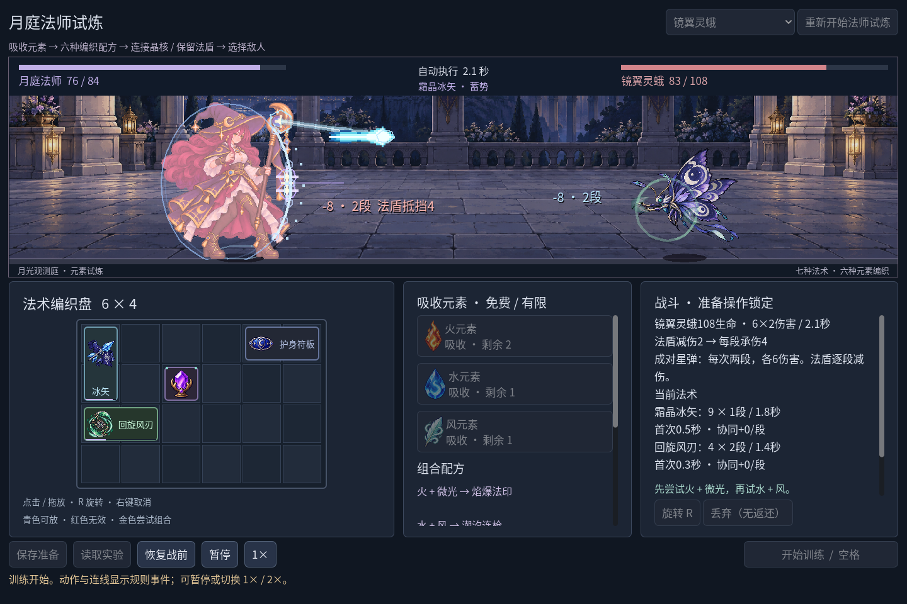

# 法师扩展：受击法盾、两种敌人与四种新魔法

2026-10-27。用户希望法师的护甲在受击时表现为护盾，同时继续完善特效、增加敌人与魔法。入口仍是 `npm run game:mage`；准备阶段在右上角选择对手，再编织和开战。

## 法盾：有减伤才显现

保留护身符板时，敌方命中会在法师身后展开半透明盾面，前方亮起弧线、纹路和碰撞波纹；数字显示真实抵挡量。它对应原有**每段减伤2**，没有新增可耗尽的盾值：剩余伤害仍会扣生命。丢弃护身符板后不再出现法盾。

例如灵蛾每次射出两段各6伤害：法盾逐段抵挡2，最终承伤8，显示“2段 法盾抵挡4”。致死时如果规则只发出第一段，就只计算和表现第一段。暂停、倍速、胜负和恢复战前都与战斗时钟同步。

相同的冰矢/风刃配置对灵蛾：保留护符时承伤32，正常舍弃护符后承伤48；两次都在9.50秒获胜，后者没有法盾特效。这是当前固定对手与配置下的对照。

## 三个可选对手

| 对手 | 生命 | 攻击 | 选择的意义 |
| --- | ---: | --- | --- |
| 月庭巡卫 | 140 | 每1.8秒单段8伤害 | 延续之前的基准一战 |
| 镜翼灵蛾 | 108 | 每2.1秒两段各6伤害 | 法盾对每段生效；较快观察多段攻击 |
| 荆棘石像 | 220 | 每3.4秒单段18伤害，提前1.1秒蓄势 | 高生命和慢速重击，考验持续输出 |

两个新敌人各有四姿势、自己的聚能与攻击效果。灵蛾悬浮，石像站地；弹道和命中点使用逐姿势核心锚点。当前是**三选一的独立挑战**，不是三连战或五战奖励流程。准备完成后锁定对手，战后恢复战前可调整构筑和重新选择。敌人选择只保留在本次运行，不写入准备存档。

## 六种二元配方

现有微光与火、水、风的四种原材料现在都有六种不同的两两编织结果。初始两份微光和每种元素两份仍是有限来源；材料、UID、占格和丢弃账本遵守原有规则。

| 材料 | 法术 | 占格 | 基础伤害与间隔 |
| --- | --- | --- | --- |
| 火 + 微光 | 焰爆法印 | 2×2 | 18×1 / 3.0秒 |
| 水 + 风 | 潮汐连枪 | 3×1 | 5×3 / 2.6秒 |
| 水 + 微光 | 霜晶冰矢 | 1×2 | 9×1 / 1.8秒 |
| 风 + 微光 | 回旋风刃 | 2×1 | 4×2 / 1.4秒 |
| 火 + 水 | 蒸汽爆破 | 2×2 | 22×1 / 3.4秒 |
| 火 + 风 | 焰风涡旋 | 2×3 | 6×4 / 2.8秒 |

此外保留基础微光术式，共七种攻击来源。晶核对连接的法术**每段+2**，一次可连接多个法术，因此四段焰风的占格和连接价值不同于单段冰矢。新法术各有图标和飞行、命中、消散效果；冰矢没有冻结，风刃没有击退，蒸汽与涡旋没有范围伤害或持续状态。

一个可复现的灵蛾构筑：将水放到左上微光生成冰矢，将风放到左下微光生成风刃。有限资源实战为9.50秒胜利、承伤32。另一个石像fixture先按正常操作舍弃两份初始微光，再在右侧编织蒸汽、左侧编织焰风；两者均连接原晶核，分别为24×1和8×4，12.10秒胜利、承伤48。这是两种固定配置的结果，不是全面平衡结论。

## 素材和已修问题

两张敌人四姿势图集和一张四图标图集由内置 imagegen 生成，[逐字提示](../assets/art/mage-expansion-v1/prompts.json)与[原图尺寸、alpha、取区和哈希](../assets/art/mage-expansion-v1/manifest.json)已保存。请求1536×1536，实际各1254×1254；原PNG未重采样。低透明和色数仍需整理，人物和敌人使用现有alpha阈值，不能宣称逻辑像素与有限色板已通过最终验收。灵蛾蓄势帧本身带月纹聚光，它不代表额外伤害。

新图标的上下两排没有按图像正中准确分隔。最初均分会把下排的蒸汽/火焰残片带进上排图标；现按左列y603、右列y600的透明间隙分区，保留所有图样。两个敌人下排也使用实测空隙，避免裁断左侧姿势。最初把命中点设在悬浮敌人的包围盒中心，会落到翅膀；现在四姿势分别标定核心位置。

## 检查与边界

| 命令 | 结果 |
| --- | --- |
| `npm run game:classes:test` | Run96 + Battle143 + Save269 + UI115 = 623，失败0 |
| `npm run game:classes:art:test` | 静态142 + 图标146 + 动作264 + 反馈62 = 614，失败0 |
| `npm run game:mage:test` | 62，失败0 |
| `npm run game:mage:vfx:test` | 49，失败0 |
| `npm run game:mage:expansion:test` | 142，失败0 |
| `npm run game:classes:feedback:render:test` | 6，失败0 |

共**1496项检查，失败0**；保存非法大指数的两个已知警告仍出现，拒绝与状态保持通过。专项检查覆盖六配方双向性、旋转/阻挡/材料守恒、四种新法术的存档往返、三种敌人、双段致死截断、护盾有无/暂停/恢复，以及三种窗口的角色位置。三种敌人的实际GPU护盾差分在战斗区外均为0。基准巡卫战斗的完整统计仍与前版一致。旧存档可读取；旧程序不认识新法术ID时会拒绝新存档，未做旧程序前向兼容。

截图是Godot实际viewport，有限取得、合成与舍弃使用正常API，录制时关闭玩家保存；构筑是可复现fixture，非人工初见试玩。[日语开发记录](devlog/2026-10-27-mage-expansion.ja.md)与[截图清单](devlog/screenshots/mage-expansion-v1/manifest.json)记录实况、裁切和对照。只验证了本机Windows、Godot 4.7.2 .NET、OpenGL兼容及NVIDIA RTX 3070 Laptop GPU；其他系统、DPI、导出包和外部玩家未验证。
