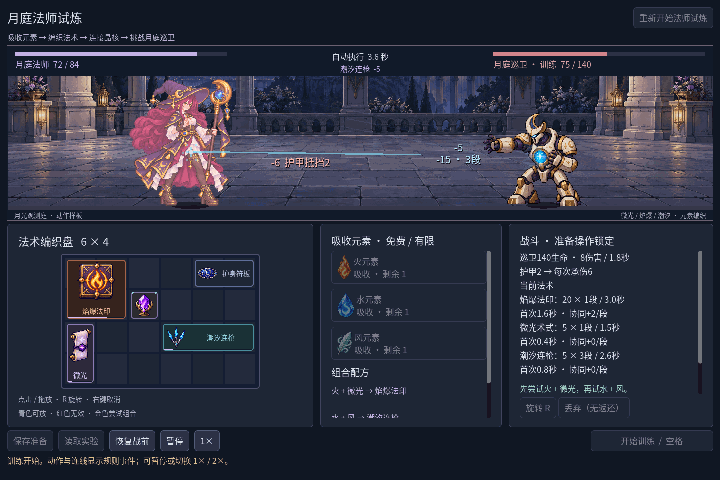
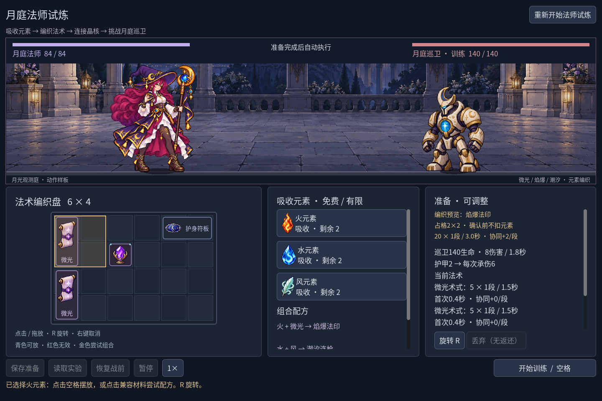
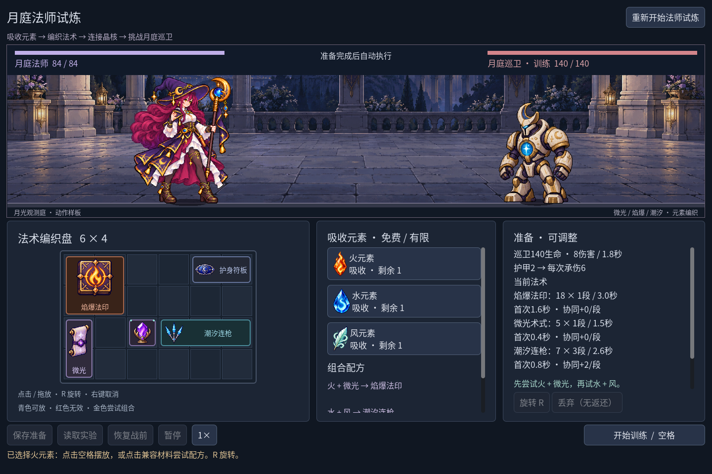

# 法师一战首版 · 2026-10-27

用户决定先做法师、敌人、特效、道具和核心玩法，骑士与C2后置。[当前计划](mage-first-plan.md)优先于旧的双职业同步顺序。本轮交付一段可玩的法师试炼，入口：

```powershell
npm run game:mage
```



## 已接入的循环

吸收有限火/水/风元素，放入6×4盘面；将火叠到微光术式编织焰爆，将水与风叠放成潮汐连枪。较大产物需要保留空间，聚能晶核只支援实际指向的相邻格，R旋转改变方向。开战后自动施法，结算可恢复同一资源配置继续调整。

本轮新增的是敌人/图标/特效和玩法可读性，**没有新增八件规则或新配方**。现有八种物件：

| 物件 | 占格 | 实际作用 |
| --- | --- | --- |
| 微光术式 | 1×2 | 5伤害，间隔1.5秒，首次0.4秒 |
| 火元素 | 1×1 | 与微光编织焰爆，来源免费且只有2次 |
| 水元素 | 1×1 | 与风编织潮汐，来源只有2次 |
| 风元素 | 1×1 | 与水编织潮汐，来源只有2次 |
| 焰爆法印 | 2×2 | 基础18伤害，间隔3秒，首次1.6秒 |
| 潮汐连枪 | 3×1 | 基础5×3段，间隔2.6秒，首次0.8秒 |
| 聚能晶核 | 1×1 | 左右相邻术式每段+2，旋转后上下 |
| 护身符板 | 2×1 | 护甲+2，巡卫每次原始8伤害通常降为6 |

## 敌人、道具与特效

- 木靶被法师场景的**月庭巡卫**替换：专用待机、蓄势、攻击、受击四姿势。蓄势读取下次真实攻击的剩余时间，攻击姿势来自实际命中事件。140生命、每1.8秒原始8伤害仍为原训练规则，没有新护盾/打断/状态机制。
- 八种图标进入格位、元素来源按钮与所选物件详情。单格物件用足够大的图标，名字在tooltip/详情中读取；其他尺寸在可用空间保留文字，字号不低于14。
- 微光为紫色星芒/轨迹，焰爆为橙色爆散，潮汐为实际段数的青色枪影，巡卫为星辉命中。特效由程序绘制，位置按2px取整，是实际事件的命中表现，不是可碰撞弹体，不决定伤害。致死时只发出一段的潮汐不会强画三段。
- 保留现有MA人物与月庭背景。主角待机仍是静态帧，专用受击/退场姿势、严格逻辑像素与生产调色板仍待完善；不将这轮称为完整美术验收。

两个新图集使用内置**imagegen**生成，实际尺寸为敌人1122×1402、图标1774×887，见[原图清单](../assets/art/mage-trial-v1/manifest.json)及[逐字提示](../assets/art/mage-trial-v1/prompts.json)。敌人下排取源分界为x624，完整保留伸出的手臂与脚；图标取443×443区域，边缘剩余未使用。原PNG未重采样或改alpha，保留部分透明/彩边，运行等比最近邻与角色阈值绘制仍是试验。

## 预览与同资源布局对照

放置预览在独立副本上运行真实取得/移动/编织事务，包括来源次数、金币、旋转、产物锚点、被消耗物件移除、空间校验和协同。它不会扣真实元素、金币或UID；失败给出真实原因，大产物被挡住时不再错误显示成可编织金框。



战前列出真实法术伤害、段数、间隔、首次等待和协同；战中每件术式的冷却条读取规则时间，实际施法高亮对应来源。暂停/倍速同步。界面查询与效果不调度攻击。

| 相同资源、同一敌人 | 晶核位置 | 焰爆 / 潮汐 | 真实胜利耗时 |
| --- | --- | --- | --- |
| 基准配置 | 第3列第2行 | 20×1 / 5×3 | 8.60秒 |
| 晶核向下移一格 | 第3列第3行 | 18×1 / 7×3 | 7.60秒 |

两者都只吸收一次火、水、风，余量各1，无额外资源。第二个配置让晶核的右侧指向潮汐。它证明在当前固定训练敌人上的位置收益，不是多种子平衡或普遍最优构筑结论。



## 保存与验证

法师入口为`scenes/mage_trial.tscn`，仅有法师重开按钮，使用独立`user://mage-trial-run.json`和现有职业检查点schema1。读取有效骑士检查点会在改状态前拒绝；不迁移、覆盖旧森林或职业实验保存。旧`game:classes`入口及骑士保持兼容。

| 执行 | 结果 |
| --- | --- |
| `npm run game:classes:test` | Run96、Battle143、Save269、UI115，合计623，失败0 |
| `npm run game:classes:art:test` | 静态兼容142、图标/文字146、动作264、反馈62，合计614，失败0 |
| `npm run game:mage:test` | 法师入口、事务预览、图集、冷却、暂停、真实事件、布局收益与存档隔离62，失败0 |
| `npm run game:classes:feedback:render:test` | 实GPU alpha读回6，失败0 |
| `node --check scripts/godot.mjs` | 退出0 |

相关检查合计**1305，失败0**，重复执行不重复计数。存档负例仍有两次已知`Exponent too high`警告，拒绝和状态保持通过。普通配置仍与独立Battle及此前记录一致；仅新增只读时间查询和隔离副本预览，没有改战斗调度、数值、配方、ID或保存格式。旧森林与C#未改，未重跑森林949项或C#构建。

正常丢弃一个初始微光的失败配置也运行验证：原84生命不改，25.20秒失败，有效输出85，巡卫剩55。新敌人存活、主角淡出，未用改数值演出失败。

## 运行证据与复现

[本版不可变清单](devlog/screenshots/mage-trial-v1/manifest.json)包含28PNG、1GIF和4JSON（基准完整运行报告、两份对照摘录、自动检查报告）。图中均为实际Godot运行，取得/编织/移动/丢弃走正常API，玩家保存禁用。基准预览fixture程序设置悬停格位后调用正常预览接口，不伪称人工鼠标试玩。

公开录像来自1440×960 Movie Maker固定16FPS的167张PNG，取71～166共96帧，1/2最近邻缩至720×480并GIF量化，6秒无声；不是性能测量。另有1280×800实际预览/构筑/潮汐、1920×1080准备画面，以及晶核图标过小的中间截图。图标过小版是旧的中间运行画面，不能当最终UI。部分对照只保存所选截图与运行报告字段摘录，清单明确其来源。

先创建新的`.tools/new-mage/movie/`目录，再执行：

```powershell
node scripts/godot.mjs mage-capture --resolution 1440x960 --fixed-fps 16 --write-movie .tools/new-mage/movie/frame.png -- --capture-dir=D:/WorkSpace/godot-demo/.tools/new-mage --auto-quit
```

同资源潮汐支援对照加`--capture-tide-focus`，失败配置加`--capture-loss`，准备截图加`--capture-prepare-only`。请使用未含旧证据的目录，同名PNG拒绝覆盖。

当前只验证本地Windows／Godot4.7.2.NET／OpenGL兼容；其他OS、独立导出包、不同DPI和外部首次试玩未验证。C2与新增骑士工作后置，后续继续法师单战的道具/敌人对抗与可读性，不扩大为六路线或五战生产。
