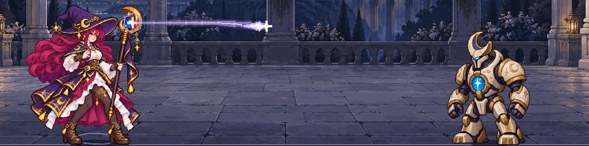

# 法师特效第二版：让玩家看到一次施法的过程

本页保留该版本的记录；此后新增的法盾、敌人和魔法见[法师扩展](iteration-mage-expansion.md)。

2026-10-27。前一版为`89ee0b9`，入口仍是`npm run game:mage`。用户反馈“特效还是很简陋”，本轮集中改善三种法术和巡卫攻击的视觉过程，没有扩展C2或骑士。

这是实际运行的有限元素取得、编织和自动战斗fixture。动图只裁取战斗区域，不包含完整操作界面；[完整窗口的焰爆命中](devlog/screenshots/mage-vfx-v2/baseline/mage-vfx-impact-flame_glyph.png)保留界面上下文。旧版[法师一战证据](iteration-mage-trial.md)保留。

## 已接入的表现

| 来源 | 聚能和飞行 | 实际命中和残留 |
| --- | --- | --- |
| 微光 | 紫色轨道、杖尖聚光、弧形彗星与渐细亮芯拖尾 | 短促星芒、扩散符环、向上消散的小星 |
| 焰爆 | 橙金聚能、带三种像素火舌变化的火团 | 分层火焰、局部热芯、扩张冲击环、飞散火星和上升余烬 |
| 潮汐 | 青蓝聚能、上下展开的三支晶质水枪、各自尾迹 | 根据真实段数出现枪刃、冲击环与晶质碎片；没有新增冻结状态 |
| 巡卫 | 胸口核心聚光、青蓝菱形星弹，向主角身体飞行 | 局部星辉冲击与碎屑；保留原8伤害/1.8秒规则 |

地面法阵位于人物后方，投射物、命中与数字在人物前方；两层都裁剪在战斗场景内。移除了法师旧的通用命中环，避免重叠成两个不相关效果。法杖发射点继续读取四姿势的独立锚点。下一次施法进入窗口时，空闲主角会进入已有准备姿势，不打断当前命中/收势；没有制作新的角色源帧。

四个小像素图样由本项目代码定义：火舌、彗星、枪刃、碎片，每个使用五种不透明颜色与透明空白，以最近邻、整数1/2/3倍绘制，火舌有三种整数像素变化并缓存。曲线、法阵和碎屑位置按2px取整。它们不是外部游戏素材，也没有重新生成主角或修改已有PNG。角色本身的受控逻辑像素仍待整理。

## 时间与规则的边界

- 读取下一次真实攻击的剩余时间，在最后0.64秒内聚能，最后0.24秒内飞行。初次攻击不足0.64秒时只显示实际可用部分。
- 规则仍按50ms步进；只读时间查询额外返回已有帧内余量，飞行用它插值，避免只有四五个跳跃位置。没有为动画提前或延迟扣血。
- 飞行显示来源计划发射的枪数；**命中只显示规则实际发出的段数**。致死后被取消的第二、第三段不会补播，战斗结束立即清除所有未来施法预告。
- 命中/残留总时长为微光0.48秒、焰爆0.74秒、潮汐0.64秒、巡卫0.48秒；前0.18秒标为命中段。暂停冻结，倍速共同推进。
- 最多显示六个即将发动的来源和八组近期实际命中，优先即将发动/最新来源。没有无界粒子节点队列，也没有为表现增加碰撞、伤害、状态或存档字段。

## 观察到的问题和修正

第一版拖尾由离散菱形组成，看起来像串珠，改为连续渐细色带、细亮芯和少量脱落粒子。[中间实机](devlog/screenshots/mage-vfx-v2/before-ribbon-fix.png)保留，不作为完成画面。初版直接使用离散冷却也会跳动，因此补入只读帧内插值。

检查绘制顺序时发现，地面法阵若直接画在父舞台里，会绕过前景裁剪；现在地面和前景各自裁剪，法阵向地面内部展开。GPU隐藏/显示两层的差分检查覆盖聚能、飞行和命中，战斗区域外变化像素均为0。差分包含数字层，因此不以像素数量代表特效品质或性能。

新图样检查最初发现碎片只用了三种颜色，而不是规定的五色明暗；补上深蓝轮廓和中间色。随后相关检查全部通过。

## 验证

| 命令 | 结果 |
| --- | --- |
| `npm run game:classes:test` | Run96 + Battle143 + Save269 + UI115 = 623，失败0 |
| `npm run game:classes:art:test` | 静态142 + 图标146 + 动作264 + 反馈62 = 614，失败0 |
| `npm run game:mage:test` | 62，失败0 |
| `npm run game:mage:vfx:test` | 新增实际GPU、四阶段、插值、暂停/倍速、致死截断、生命周期和保存隔离45，失败0 |
| `npm run game:classes:feedback:render:test` | 角色alpha实际GPU读回6，失败0 |

合计**1350项检查，失败0**，重复执行不叠加计数。保存非法大指数负例仍输出两次已知`Exponent too high`，拒绝和状态原子性检查通过。`node --check scripts/capture-demo-gif.cjs`与`git diff --check`通过。

归档24PNG、1GIF、4JSON共29件，尺寸/bytes/SHA-256与清单一致。26文本UTF-8、285本地引用无异常；GIF解析确认144帧/6秒。转换器另验证旧参数720×480、原寸裁剪1056×262、越界拒绝与已有输出保护，不叠加为战斗检查数。

实际基准依然8.60秒获胜、有效伤害140、承伤24；完整战斗统计与独立规则运行及上一版一致。检查也保护三个玩家存档指纹。1280×800、1440×960、1920×1080都有实际特效截图；GPU边界差分在1440×960完成。仅确认本机Windows/Godot4.7.2.NET/OpenGL兼容/NVIDIA RTX3070 Laptop GPU，未测试其他平台、DPI、导出包或外部玩家。

## 记录与后续

[日语开发记录](devlog/2026-10-27-mage-vfx.ja.md) · [版本截图与转换清单](devlog/screenshots/mage-vfx-v2/manifest.json)。保留上一版、串珠中间版和当前完成版，报告明确区分完整GPU测试报告与选择字段的原生截图报告。

动图从243张1440×960的Movie Maker原生PNG中取第18～161帧，共144张；固定24FPS，裁剪`[208,152,1056,262]`，不缩放，GIF调色板量化，无声6秒。录制帧率不是实测游戏性能，裁剪也不代表完整界面。

本轮仍是一战、两配方。没有音效、灯光照亮背景、屏幕震动、专用受击/倒地源帧、新敌人机制或新法术路线；单个主角代表多个自动来源时，准备姿势仍有优先次序。后续可继续做施法/命中音效与合成成功反馈，再单独设计能让玩家应对的敌人机制。
