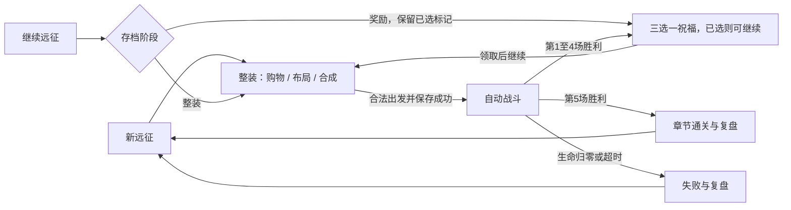

# 星火旅囊 / Emberpack：产品需求文档

版本：1.0 · 日期：2026-10-21（JST） · 实现基线：Demo 0.2，提交 `0e90bcb`。

本文定义下一阶段可玩 Demo 的目标，供开发、试玩和验收使用。**当前已实现**与**计划实现**分别列出；下文的数量、节奏和体验指标均为本项目目标，不是《靠装勇者》的原版规格。本文与[开发计划](development-plan.md)、[美术规格](art-direction.md)、[参考研究](reference-research.md)一起维护。

## 1. 产品定位

一个 Windows 桌面端、离线单人、原创像素幻想风的背包合成自动战斗 RPG。玩家的主要操作发生在战斗前：购物、腾出空间、旋转装备、选择合成分支与连接协同；自动战斗负责让这些选择产生清楚可读的后果。

核心体验是：**为了下一场敌人改变背包，通过合成得到有辨识度的装备，战后能看懂这次构筑为什么赢或输。**

目标用户是喜欢背包整理、配方发现和短局构筑的人。默认使用鼠标，快捷键加速操作；不要求玩家事先查 Wiki。熟悉后的单局目标为 5–8 分钟，首次带引导目标为 8–12 分钟，均需后续实际试玩验证。

保留原创「青绿森林遗迹、暖色灯火、橘围巾旅人」主题。游戏界面保持中文；开发过程、问题记录和博客素材继续使用日语。

## 2. 参考转化与边界

| 参考依据 | 提取的体验 | 本项目决定 |
| --- | --- | --- |
| [官方介绍](https://overgeared.app/)及[官方商店页](https://play.google.com/store/apps/details?hl=zh_CN&id=com.fiveminlab.overgeared.hero.backpack.merge&listing=website) | 布局、合成和装备组合建立战斗能力 | 采用战前构筑、战中自动执行的主循环 |
| [Wiki 研磨石](https://tatakingdom.tw/zh-TW/games/overgeared-hero/items/warrior-smithingstone) | 支援效果依赖明确连接位置 | 保留可视化方向格，并展示实际受益装备 |
| [Wiki 长剑](https://tatakingdom.tw/zh-TW/games/overgeared-hero/weapons/warrior-longsword) | 大装备占空间，底材存在多个合成去向 | 强化必须包含空间代价；新增配方优先形成分支 |
| [Wiki 药水](https://tatakingdom.tw/zh-TW/games/overgeared-hero/items/neutral-hppotion) | 恢复物品也能构成配方网络 | 为生存路线保留独立价值；具体触发规则自行定义 |
| [MGGames 实机](https://www.youtube.com/watch?v=ydIPYpirNjY)、[Zy 实机](https://www.youtube.com/watch?v=OiVQdJ-XikI)、[TanJinGames 实机](https://www.youtube.com/watch?v=9WkzU8AMfuQ)的多段 storyboard 采样 | 战斗时仍可看见背包；装备有激活反馈；轮廓、品质色、详情卡帮助辨认 | 背包与战斗同屏，触发装备和战斗事件对应；见研究文档的实际采样范围 |
| Wiki 的职业、专用品和宠物目录 | 后续扩展能围绕不同构筑身份组织 | 先以一名英雄验证三条路线，多职业和宠物延后 |

视频仅查看采样图，未完整连续观看，也未据此确认原作合成触发时机或精确数值。本项目保留「叠放即时合成」，不加入“相邻打完一场再合成”的规则。原作 UI、角色、图标、音乐和数值表均不直接复制。

## 3. 当前基线与差距

| 系统 | v0.2 已有能力 | 仍需补齐 |
| --- | --- | --- |
| 背包 | 6×4 固定矩形，矩形占格、拖放、旋转、越界/碰撞保护 | 更明确的落点和失效原因，操作撤销 |
| 商店 | 四格，购买/刷新/出售；7 种基础商品池 | 分阶段权重、单格锁定、购买前影响预览 |
| 装备 | 12 种，最高 3 级，同物升级及 5 条异物配方 | 装备详情完整、分支辨识、至少三种有效构筑 |
| 协同 | 磨刀石左右/旋转上下，火种四向 | 受益对象与实际增益联动展示 |
| 战斗 | 武器独立冷却、全局暴击、护甲、反伤、回复、药水、1×/2×速度 | 装备事件专属表现、真实敌人技能、可复盘统计 |
| 关卡 | 固定 5 战，最终 Boss | 提示对应实际机制；目前敌人主要是生命、伤害和间隔差异 |
| 成长 | 7 个祝福，前四场胜利后三选一 | 与构筑方向更紧密；当前不代表已经完成平衡 |
| 保存 | 整装/奖励自动保存，战前检查点，严格验证，坏档保护 | 新字段迁移、独立玩家设置保存 |
| 教学 | 初始提示和帮助文字 | 按真实操作推进、可跳过/重看的教学 |
| 表现 | 原创森林背景、静态像素角色/图标、位移/闪白、合成提示音 | 统一像素比例、动画和材质；方图被拉成长装备的问题 |

v0.2 的焰纹大剑是更强的数值武器，**尚无灼烧系统**；物品种类不等于独立流派。已有记录为 385 项检查（核心 126、存档 148、UI 111），主要证明规则与流程，不能证明新手理解、美术质量或多流派平衡。本轮为文档工作，不将该记录描述为新一轮测试结果。

## 4. 目标 Demo 的内容预算

目标版本为 **v0.5：第一个可对外试玩的完整章节**。v0.3、v0.4 的中间交付见开发计划。

| 内容 | 目标预算 | 约束 |
| --- | --- | --- |
| 英雄 | 1 名 | 用装备路线改变玩法，不另做职业系统 |
| 区域与流程 | 1 个森林章节、5 场固定顺序战斗 | 第 4 场精英，第 5 场 Boss；不做分支地图 |
| 背包 | 6×4，24 格 | 本阶段不做扩包、不规则包袋或临时仓库 |
| 装备 | 总计 16 种 | 在现有 12 种上新增 4 种；新增前先完成样板与规则数据整理 |
| 异物配方 | 总计 8 条 | 新增 3 条；至少一个底材存在两个可选去向；同物升级另计 |
| 品质 | 3 级 | 不再另加六档稀有度体系；商品抽取权重与升级等级分开 |
| 祝福 | 9 个 | 现有 7 个加 2 个；每次仍三选一、不可重复领取 |
| 构筑方向 | 焰刃持续伤害、猎弓暴击、荆棘续航 | 不是职业锁定；允许混搭，需说明各自核心、空间成本与短板 |
| 新状态 | 灼烧 1 种 | 本阶段不同时加入毒、冰冻、眩晕与抗性矩阵 |
| 敌人机制 | 3 种可观察机制 | 用连击、护盾阶段、Boss 蓄力重击等形成差异，细则在规则原型中定稿 |
| 交付 | Windows 离线试玩包及源码 | 本机编辑器开发流程保留；其他平台另立验收 |

四件新增装备的名称和完整数值在 v0.4 规则原型后确定，避免先制作最终美术再推翻机制。每件必须有独立作用、获取途径、占格、数值描述和至少一个明确取舍，不能仅为凑数量。

## 5. 玩家流程与状态

菜单和帮助是暂停叠层，不是独立战斗阶段。打开后暂停模拟、冷却与动画时间；关闭继续。存档只恢复整装或奖励阶段；战斗中退出，继续时回到该场战前检查点。当前 90 秒战斗超时判负规则保留，界面须明确告知。

## 6. 功能需求与验收

优先级：P0 为目标 Demo 必须满足，P1 为在核心完成后加入的增强。状态仅表示 v0.2 基线，未完成项不能因出现在此表就视为已实现。

| ID | 需求 / 优先级 | 基线状态 | 目标验收 |
| --- | --- | --- | --- |
| FR-01 | 远征流程与随机种子 / P0 | 已有，待增强 | 五场胜败/重开无死路；普通新局生成随机种子，测试可传固定种子；继续游戏不改变 RNG 序列 |
| FR-02 | 渐进教学 / P0 | 新增 | 引导购买→摆放→旋转→同物/异物合成→看方向增益→战斗→选祝福；按实际成功操作推进，可跳过和重看，不能因一次误放卡住 |
| FR-03 | 背包与操作反馈 / P0 | 部分 | 显示占格、方向、合法/非法/可合成三种预览及失败原因；无效操作不丢物、不扣钱；战斗中操作明确禁用；移动、旋转、背包内合成支持撤销最近一步 |
| FR-04 | 商店与经济 / P0 | 部分 | 维持四格、刷新与出售；增加单格锁定及阶段权重；锁定格刷新不变，购买后解除；显示实际价格和余额不足原因；无免费套利路径 |
| FR-05 | 合成与图鉴 / P0 | 部分 | 保留即时叠放；同物同级升一级、上限 3；异物结果继承材料最高等级；产物放不下则原子失败；配方显示已拥有/缺少材料和产物占格，不预先扣除材料 |
| FR-06 | 详情、协同与属性 / P0 | 部分 | 每件可见伤害/间隔、护甲/反伤、回复/治疗等适用数值；标明单件或全局作用；购买/旋转/合成预览比较至少攻击、护甲、回复、暴击；估算 DPS 与实战不同处注明 |
| FR-07 | 三条构筑与内容 / P0 | 部分 | 完成 16 件/8 配方/9 祝福；三路线各有核心装备、协同、升级取舍、优势和短板；各至少有一条合法购物流程可打通五战，不使用调试加钱 |
| FR-08 | 自动战斗与状态 / P0 | 部分 | 继续按固定步长模拟；伤害/回复/反伤都有来源 ID；灼烧周期伤害、重复施加策略和结算顺序明文定义且与说明一致；1×/2×及暂停不改变同种子结果 |
| FR-09 | 敌人与章节 / P0 | 部分 | 5 场难度有职责；3 类特殊机制真实执行、带预告和图标；Boss 轮廓/动作区别于精英；战前提示给可采取的准备建议，不能仅写不存在的技能 |
| FR-10 | 奖励与成长 / P0 | 部分 | 前四场各三选一，未选不能继续，不能重复领取；祝福卡给出增益，存在代价时直接显示；已拥有祝福可回看；奖励/商店变化可保存恢复 |
| FR-11 | 战斗复盘 / P0 | 新增 | 胜败都显示时长、伤害来源、反伤、治疗与承伤；前三来源可定位装备；失败说明最后致死来源/超时，允许回看背包再重开 |
| FR-12 | 保存与设置 / P0 | 部分 | 继承坏档与写入失败保护；schema 1 合法档可迁移新格式，迁移前保留备份；未知版本拒绝并提示；音量、静音、教学状态独立保存，重开不清设置 |
| FR-13 | 可读界面和原创美术 / P0 | 部分 | 按[美术规格](art-direction.md)完成比例、角色动作、12 件先行资产及后续新增资产；1280×800 / 1440×960 无裁切、点击偏移；1920×1080 检查留白与缩放；颜色以外还有图标/形状提示 |
| FR-14 | 声音与反馈 / P1 | 部分 | 购买、旋转、合成、剑击、箭矢、受伤、恢复、奖励可区分；连发不相互截断或削波；总音量和静音有效；背景音乐/环境声独立于战斗提示 |
| FR-15 | 离线交付与记录 / P0 | 部分 | 无编辑器的干净 Windows 环境能运行导出包，不需联网登录；附启动/操作/已知问题和素材来源；保留日语开发记录、实际运行截图与对应提交 |

撤销范围刻意限定为整装时的**移动、旋转和背包内合成**。购买、出售、刷新、奖励、战斗不可撤销；这些操作会清除撤销记录。撤销后重新自动保存，不提供通过撤销刷新来预览商店随机结果的路径。新增撤销不改变当前“放下即合成”的触发方式。

## 7. 三条构筑的设计约束

| 路线 | 核心体验 | 空间与资源代价 | 待验证的短板 |
| --- | --- | --- | --- |
| 焰刃 | 大剑命中与灼烧形成持续压力 | 大武器占三格，支援与合成材料挤占生存格 | 面对短时间高爆发时，伤害尚未兑现就被击败 |
| 猎弓 | 高频攻击与暴击形成直接反馈 | 长条弓及辅助连接占空间，不能无代价同时堆防御 | 暴击收益不稳定，血量/防护投入不足时脆弱 |
| 荆棘 | 减伤、恢复和反伤撑过连击 | 防御物品压缩主动伤害空间 | 攻击频率低的敌人或超时限制降低收益 |

这些是**设计假设**。v0.4 通过固定种子策略模拟和实际试玩验证；不承诺三条路线对所有敌人同样有效。火、弓、盾不是互斥职业，不限制玩家混搭。

## 8. 质量要求与体验验证

| ID | 要求 | 验证方式 / 边界 |
| --- | --- | --- |
| NFR-01 | 操作原子性和复现 | 同种子、同操作序列产生同一规则结果；失败购买/合成无资源变化；保留现有回归 |
| NFR-02 | 流畅和响应 | 1440×960、1×/2×战斗在本开发机以 60 FPS 为目标；记录硬件及采样，不预称所有电脑达标；点击后下一帧提供视觉反馈 |
| NFR-03 | 可读与易用 | 最小支持窗口 1280×800；正文目标至少实际输出 16 px、主要命中区至少 40×40 px；低于最小尺寸给明确约束，不强行缩小文字 |
| NFR-04 | 本地与离线 | 游戏不依赖 MCP/网络运行；SDK/npm/缓存保持项目内；玩家存档不提交 Git |
| NFR-05 | 可维护与一致 | 装备定义统一提供规则、详情、图鉴和美术键；表现只消费战斗事件，动画不决定伤害；避免继续向单一绘制脚本堆全部功能 |
| NFR-06 | 素材与记录 | 原创或明确许可资产；记录来源/许可/生成方法；实机、概念图、测试 fixture 各自标明 |

在 v0.5 安排 3–5 位初次试玩者作为小样本，记录是否能独立完成首购、旋转、合成、解释一项协同，以及能否说出失败的可调整原因。首轮以第一次战斗获胜并领取祝福为终点，允许使用游戏内教学，不由观察者代操作或口头给步骤。目标为至少 `ceil(0.8 × n)` 人独立完成（n 为实际人数：3 人需 3 人、4 人需 4 人、5 人需 4 人）。报告实际人数与观察，不将小样本比例解释为总体统计。单局时长从进入整装到结算测量，暂停与教学时间分开记。

平衡至少记录三条策略在同一组不少于 30 个种子下的通关数、死亡关卡、时长、剩余生命与购物轨迹。策略脚本只是有限近似，不把“脚本通过”当作玩家体验通过，也不为了目标胜率而把明显错误构筑一律放行。

## 9. 本阶段不做

多职业、宠物养成、永久战力、抽卡、付费、广告、账号、云存档、联机/PvP、公会、离线收益、无限关卡、程序生成地图、背包扩容与临时仓库。完整键盘焦点、手柄、触屏、移动端、Web 导出与多语言游戏 UI 另立需求。

若试玩表明「固定 24 格缺少成长」或「满包腾挪过于繁琐」，在目标 Demo 完成后再从扩包或暂存中选择一个验证，不在同一轮同时加入。

## 10. 需求变更与交付判定

新需求先写明解决的玩家问题、影响的 FR、替换/延后的既有任务和存档影响。数量增加不自动提高优先级。版本交付需同时具备：可运行结果、相应验收证据、已知限制、日语开发记录、版本截图和 Git 提交。

v0.3 只代表视觉与交互基线达成；v0.4 代表构筑和敌人机制可验证；v0.5 才以本需求的完整章节标准验收。各阶段完成状态以[开发计划](development-plan.md)为准。
