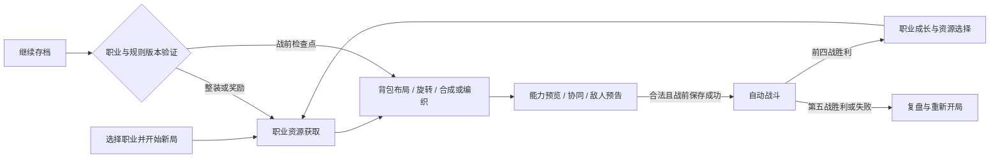

# 多职业背包构筑 RPG：产品需求文档（新标题待定）

版本：2.6 · 更新：2026-10-27（JST） · 默认游戏：v0.3森林样板；职业场景已有C1四帧动作与战斗反馈；双A外观基准已确认。

本文与[职业与流派设计](classes-and-builds.md)、[开发计划](development-plan.md)、[美术规格](art-direction.md)共同作为当前基线。**已实现、用户确认的产品方向、设计提案和待验证规则分别标注**；目标数量与节奏属于本项目，不是参考游戏的原版规格。

2026-10-27新增[战斗反馈](iteration-c1-feedback.md)：实际有效伤害、多段提示和护甲抵挡、受击闪色/轻晃、胜负淡出，暂停和倍速同步。角色绘制层过滤alpha<0.5并将保留内部画为不透明，不改源PNG、规则或存档。重绘试验未通过而未替换原动作；源像素与逐帧一致性、待机循环、专用受击/退场姿势仍未验收。下述26日动作交付是此前阶段，不代表本轮补出了这些专用姿势。

2026-10-24 实现的[C0规则实验](iteration-c0-rules.md)继续通过 `npm run game:classes` 游玩：有限元素吸收/两种法术编织、有限补给/重刃锻造、6×4布局与方向支援、来源复盘和独立战前存档，仍只打一场固定训练敌人。2026-10-26先接入[C1静态美术样板](iteration-c1-static-art.md)，随后增加[四帧动作样板](iteration-c1-motion.md)：MA施法、KA长剑/重刃，按真实charge/命中事件播放，暂停与倍速同步；原规则与存档未改。受击/退场、专用敌人/物件美术、召唤/循环/盾反/连击与职业五战尚未完成，C0整体与C1仍未完整验收。默认 `npm run game` 仍运行森林样板。

2026-10-24 美术更新：[双职业六套造型比较](character-design-review.md)提供六张1024×1536透明PNG、离线对照页和 `npm run art:review` 原生静态审稿台。用户已选择**魔法师MA「月庭礼装」与骑士KA「旌旗长枪」**作为外观基准，保留两位成年女性的脸、发型、衣甲与代表器具方向，具体约束见[已选角色基准](character-baselines.md)。这些概念不是专用战斗帧、动画或新背景实装；比例、装饰密度与原始alpha仍有待修正，RV-02未完整通过，RV-03尚未完成。

静态原图为1122×1402，背景为2172×724，见[静态清单](../assets/art/c1-static-v1/manifest.json)；新增三张专用动作图集也各为1122×1402，见[动作清单](../assets/art/c1-motion-v1/manifest.json)。源图未达受控逻辑像素网格，运行采用等比最近邻的非整数适配试验；透明彩边、源密度、逐帧体形和背景取景仍需整理。动作接入先验证接口与时序，未以前一轮静态品质已过审为前提；目前只有RV-03静态和RV-04施法/攻击的部分证据，不能声明逻辑源帧、完整动画或C1已完成。

## 1. 最新决策与产品定位

用户在八个美术方向展示后明确：**背包构筑仍是核心，不同角色拥有不同职业、玩法、资源获取方式和背景；每个角色至少支持三种构筑流派。** 不必从八案里只选一个世界，也不把职业差异限制为同一套装备改名换图。

初期确定**魔法师与 H 方案的近战圣匣骑士**。法师可吸收、收集元素并组合强力魔法，也能走召唤等路线；骑士以武器、护具与近战战术为核心。炼金术士作为后续角色，围绕自我强化、药水组合等设计，不进入首批双职业交付。外观已选MA的紫发琥珀眼、宽帽层裙与月杖，以及KA的栗发高马尾、象牙金甲、红披风与长枪。KA长剑/重刃持握和四帧攻击已按此衣甲另画，人物身份与C0武器规则保持一致；长枪战斗规则、受击与退场尚未实现。新标题、姓名、精确色值和受控逻辑源画布仍待确定。

定位：Windows桌面端、离线单人、精细像素幻想风的背包构筑自动战斗RPG。玩家战前获取职业资源、安排空间、组合能力、选择成长；战斗展示构筑效果，复盘帮助理解下一次如何调整。

背包是共同玩法结构：**6×4空间、摆放、旋转、组合、方向协同、战前决策与自动战斗**。不同角色可表现为咒印星盘、武装架、遗物祭台或炼金工作台；不强求同一个皮包，也不强制所有能力从金币商店购买。主题外框不改变默认矩形格位，职业专属规则必须单独说明。

此决策取代先前「非背包八选一」「只做一名英雄」「只允许视觉映射、不新增职业机制」的限制，也取代旧v0.4单英雄16装备/8配方/9祝福的当前承诺。旧代码、存档和证据保留；完整职业目标不能用本轮规则原型代替验收。

当前纯美术改造仍遵守现有12装备/5配方/7祝福/5战的回归边界。这里新增的是后续职业需求，新增状态与敌人规则仍属M2/v0.4性质的规则工作，不能混入M1视觉替换。C0–C3是新范围的工作拆分，不是本次修改游戏规则或宣布版本发布。

## 2. 共同循环与职业差异

目标流程沿用每局五战，第4战精英、第5战Boss，不加分支地图。每职业有自己的起始资源、获取选择、配方、成长与背景；可复用战斗框架和相同职责的敌人，不要求先制作两套完全独立的五关系统。

**设计假设：**「手搓魔法」首先指战前亲自选择、摆放并组合元素，战中按编织结果自动施放，不做手速搓招。召唤、反击与连击也由规则自动执行。主动施法和战中指挥如后续需要，应另列操作/暂停要求，不在实现中默默改变共同循环。

法师主要从有限元素来源和战后选择取得素材，骑士主要通过补给、战利品与锻造取得装备。两者共享资源预览、背包合法性和失败保护，但不强制同一金币经济；法师可有辅助商人，核心仍须体现吸收与编织。

## 3. 已实现基线与新增目标

| 范围 | v0.3森林样板已实现 | 新目标（部分有独立C0原型，非完整交付） |
| --- | --- | --- |
| 背包 | 6×4、拖放、旋转、碰撞/越界保护 | 两职业共用操作，各自组合语义；撤销与完整预览 |
| 资源与内容 | 金币四格商店、12装备、5异物配方、最高三级 | 法师元素获取/编织，骑士整备，逐职业内容清单 |
| 职业与流派 | 一名森林旅人，无独立职业系统 | 两职业，各至少三条有机制差异的路线 |
| 战斗 | 冷却、暴击、护甲、反伤、回复、药水、1×/2× | 元素组合、召唤实体、施法循环、近战触发与来源统计 |
| 关卡与成长 | 五战、前四战三选一、7祝福 | 各职业成长池和有效流派支持，预告对应真实机制 |
| 保存 | 整装/奖励保存、战前检查点、坏档保护 | 职业ID、职业资源/配方状态、规则版本与旧档处理 |
| 美术 | 响应式UI、森林、主角/苔团动画、三件专用物品图 | 两职业精细人物、独立背景/矩阵、动作与效果 |
| 教学与复盘 | 基本帮助、图鉴、敌人说明 | 各职业获取→组合→战斗教学与可解释复盘 |

v0.2的385项、v0.3样板的949项检查均为历史记录，不能证明双职业和六条流派已可玩或已平衡。当前范围见[样板记录](iteration-03-sample.md)。八张图仍是[美术概念](art-style-exploration.md)，不是运行截图或生产精灵。

## 4. 两职业、至少六条流派

以下是基于用户方向的**首轮设计提案**。两职业与每职业至少三条路线是已确认要求；路线工作名、精确资源/配方/数值/触发细则经规则原型后定稿。获取链示例与逐路线验收见[职业与流派设计](classes-and-builds.md)。

| 职业 / 路线 | 核心动作与战斗差异 | 空间与资源取舍 |
| --- | --- | --- |
| 魔法师 M-01：元素编织 | 收集火、水、风等元素，亲自拼配成强法术，战中自动释放 | 保留素材转型或消耗素材成型；法术、供能、防护争空间 |
| 魔法师 M-02：契约召唤 | 元素与契约产生有独立行动的召唤物 | 契约占格、维持资源、数量上限限制铺场，本人防护不可无代价兼得 |
| 魔法师 M-03：奥术循环 | 施法返还、元素回收与屏障构成续航循环 | 回收/稳定组件挤占爆发格；触发必须有界，不能无限施法 |
| 圣匣骑士 K-01：重刃破阵 | 大武器蓄势、强化后集中重击 | 武器占格大、成型慢，需分配支援和生存 |
| 圣匣骑士 K-02：盾誓反击 | 防护/格挡触发反击窗口 | 防具挤占主动伤害，受敌人节奏与超时限制 |
| 圣匣骑士 K-03：连击追猎 | 轻兵器连续触发、累积连击后追击 | 多组件/节奏支援占位，单次重击与防护较弱 |

同职业允许混搭、过渡和改构筑，不要求开局锁路线。六条路线各有独立核心、获取链、组合/方向决策、战斗反馈、优势与短板，不能只换颜色、名称或系数。

召唤须体现实体归属、行动、目标、上限和退场，不能把武器图标换成小动物就算完成。首轮可限制规模，但未实现召唤不能通过完整初期验收。召唤是本局职业战斗实体，**不等于宠物养成**，不追加喂养、永久升级或独立宠物经济。

后续炼金术士暂拟三路线：自我强化（饮用与增益窗口）、药水混合（基液与成分配伍）、催化投掷（延迟反应/区域效果，细则待定）。其余美术概念保留为未来角色灵感，不同时承诺实现。

## 5. 内容预算与分段交付

| 内容 | 首个切片C1 | 完整初期Demo C2/C3 |
| --- | --- | --- |
| 职业 | 法师、H近战骑士各一名 | 同两职业，不提前追加炼金术士 |
| 流派 | 暂拟元素编织、重刃破阵各一条，C0冻结 | 每职业至少三条，共至少六条可验证路线 |
| 流程 | 每职业获取→准备→一战→反馈 | 每职业独立五战→成长→胜败复盘 |
| 内容 | 每职业一条有效资源/配方链 | 六路线支持链、升级/转型与空间代价 |
| 美术 | 各一主角、背景片段、矩阵、关键物件 | 按通过样板扩展必要敌人、物件、奖励和UI |
| 数量预算 | 验证核心循环所需的最小清单 | C0/C1按路线覆盖矩阵冻结共享与专属清单 |
| 交付 | 开发切片与真实运行证据 | Windows离线试玩包、来源、记录与限制 |

旧12/5/7是样板事实，不是每职业配额；不继续套用16/8/9全局目标，也不直接乘成两份。C0按各流派的核心、获取、分支、支援和短板列覆盖矩阵，再冻结元素/法术/契约/装备/成长的最小数量，不为凑数堆物品。

**两路线切片不等于双职业三流派完成。** 不能只给六个名称、三套调试加钱存档或三种外观就称完整初期目标达成。新增状态和敌人机制服务职业验证，种类、规则和数值先原型，不先堆满毒/冰/抗性等系统。

## 6. 功能需求与验收

P0为完整初期Demo必须满足，P1为核心验证后的增强。下表是目标，不是完成表。

| ID | 需求 / 优先级 | 目标验收 |
| --- | --- | --- |
| FR-01 | 职业与远征流程 / P0 | 选职业开新局，两职业起始配置/资源入口/五战进度明确；继续不换职业、不重抽RNG |
| FR-02 | 职业教学 / P0 | 共用摆放/旋转/组合教学；法师教吸收→编织→施放，骑士教补给→整备→重击；按成功操作推进，可跳过/重看 |
| FR-03 | 背包与反馈 / P0 | 6×4默认矩阵，显示占格/方向/合法/非法/可组合与原因；无效操作无损，战中禁整备；整装移动/旋转/内部组合可撤销 |
| FR-04 | 职业获取与经济 / P0 | 骑士有补给/战利品链，法师有有限吸收/选择链；成本/收益/空间/放弃后果可见；失败回滚，防重复吸收和刷新套利 |
| FR-05 | 配方与编织 / P0 | 各职业规则统一生成预览、图鉴和结果；元素组合产出真实法术；产物无空间或材料不足不消耗，等级等规则明示 |
| FR-06 | 详情与协同 / P0 | 单件/全局/实体数值、成本、触发、方向受益清楚；购买/吸收/旋转/组合有影响预览；估算与实战不同处注明 |
| FR-07 | 每职业至少三流派 / P0 | 两职业各三条，共至少六路线，均有核心机制、合法获取链、空间代价、优势短板和无作弊五战可行例 |
| FR-08 | 自动战斗与结算 / P0 | 固定时序、1×/2×/暂停同种子一致；消耗/回收/连击/反击结算明文定义；防无限返还、递归与重复击杀奖励 |
| FR-09 | 敌人与职业背景 / P0 | 两职业各有匹配身份/场景/敌人表现，可复用规则框架；机制真实且有预告；不靠同色加伤制造虚假路线差异 |
| FR-10 | 职业成长 / P0 | 前四战选择支持三路线和转型，不能重领，不给本职业完全无用的核心奖励；已选可回看 |
| FR-11 | 战斗复盘 / P0 | 按法术/装备/召唤来源统计伤害、反击、治疗、屏障吸收与成本；解释死亡/超时，可回看构筑 |
| FR-12 | 职业存档 / P0 | 保存职业ID、规则/内容版本、资源/配方结果/奖励/RNG和检查点；旧档不静默转新骑士；迁移或legacy恢复有备份，失败不覆写 |
| FR-13 | 两职业精细美术 / P0 | 按RV逐职业验收人设、专用战斗精灵、背景/矩阵和动作；造型三案不等于三条玩法流派；实机脸/发束/武器可读 |
| FR-14 | 声音与反馈 / P1 | 区分吸收/编织/施法/召唤/重击/防护/反击/连击；表现跟随规则事件，不额外结算伤害；音量与暂停有效 |
| FR-15 | 离线交付与记录 / P0 | 干净Windows离线运行双职业包，无MCP/SDK依赖；操作、存档、来源、已知限制、日语记录和版本证据齐全 |
| FR-16 | 职业边界与扩展 / P0 | 共用格位/阶段/时钟/事件；职业配置获取/配方/触发/成长/背景；切新局无资源残留，拒绝非法跨职业内容 |
| FR-17 | 召唤生命周期 / P0 | 归属、成本、上限、目标、行动和退场明确；战败/重开清理；恢复战前检查点不复制实体或资源 |

撤销覆盖整装移动、旋转、背包内组合，并完整恢复被消耗素材与能力状态。吸收/领取、购买、出售、刷新、奖励、战斗不在撤销范围，发生时清空撤销记录，防预览随机收益；撤销后重存。涉及外部资源的组合是否可撤销在C0定义，不可只回退图像不回退资源。

## 7. 技术与兼容性

- 原生Godot工程，npm/.NET SDK/缓存项目本地，使用 scripts/godot.mjs。游戏运行不依赖MCP或网络。
- 共用层负责格位、输入、碰撞、阶段、规则时钟、保存和事件；职业层提供起始资源、获取、组合、触发与美术键，避免单UI脚本堆职业分支。
- 保留 EmberRun / EmberSave 和旧物品稳定ID，不为改标题全局重命名。新增职业/规则字段；旧档显式legacy规则恢复或经验证的备份迁移，不等同新骑士，不重抽商店/RNG。
- 保存阶段仍为整装或奖励，战中退出回战前检查点。元素、实体、连击、增益的局内/战内持久性逐项定义，不保存一半动作，不重复发战利品。
- 获取/组合/领取均原子执行；召唤/反击/回收/连击具有确定顺序和有界触发，禁止同事件无限派生自身。
- 法力是否单独成条、元素数量/配比/形状、召唤目标与上限、格挡/屏障细则待C0/C1验证；本文件不是已平衡数值表。

## 8. 质量目标与验证

| ID | 要求 | 证据与边界 |
| --- | --- | --- |
| NFR-01 | 原子性与复现 | 同职业/种子/操作同结果，失败获取/组合无损，固定步长与暂停一致 |
| NFR-02 | 流畅与响应 | 开发机目标60FPS，记录硬件/分辨率/实体规模/采样；点击下一帧反馈，不预称所有电脑达标 |
| NFR-03 | 可读性 | 最小1280×800，另检查1440×960/1920×1080；正文目标实际16px、主要命中区40×40px；不挤小文字容纳大角色 |
| NFR-04 | 本地离线 | 游戏无联网依赖，工具项目本地，存档/凭据不提交 |
| NFR-05 | 一致与可维护 | 规则、图鉴、详情、预览与模拟共用定义；表现消费事件，动画不决定伤害 |
| NFR-06 | 素材与记录 | 16-bit fantasy/tactical RPG细节；原创或明确许可，记录生成与来源；概念、fixture与实机分标 |

完整验收覆盖两职业六路线；每职业三条已记录策略，在同一组不少于30种子下比较，保留各职业合法获取序列，不强迫同购物清单，也不调试加钱。报告胜负、死亡关卡、时长、剩余资源与构筑轨迹，验证机制/获取链成立及明显必选项，不虚构胜率、不承诺全路线克制全部敌人。

C3安排3–5位首次试玩者作小样本，记录职业、获取/旋转/组合/协同理解和失败解释，观察覆盖两职业；没有试玩的职业记未验收。首轮以首战和成长选择为终点，可用游戏内教学，观察者不代操作；独立完成目标 ceil(0.8×n) 只针对该样本，不外推总体。熟悉后5–8分钟、首次8–12分钟仍是待测单局目标，按职业实测并分记暂停/教学时间。

## 9. 初期不做与未来扩展

炼金术士及其他新增职业暂不进首批；宠物养成、永久战力、抽卡付费、广告、账号云存档、联机/PvP、公会、离线收益、无限关卡、程序生成地图、扩包和暂存不在初期范围。键盘完整焦点、手柄、触屏、移动端、Web导出与多语言UI另列验收。游戏中文，开发记录和博客日语。

新职业以「独立资源循环＋至少三种可玩流派＋背景和美术」为基本扩展单元，不能只加一张立绘。炼金术士可复用验证过的资源/配方/状态接口，专属规则在双职业完成后再定。

## 10. 参考与交付判定

空间代价、合成和方向支援的参考及视频采样范围见[参考研究](reference-research.md)。此前的[Wiki](https://tatakingdom.tw/zh-TW/games/overgeared-hero)和视频研究不证明本项目元素/召唤/骑士规则已验证；本轮没有新增网页/视频调查，设计来自用户方向与本项目提案，不直接复制原作素材和数值。

交付顺序：C0职业设计与接口 → C1双职业一战切片 → C2双职业六路线五战 → C3教学、平衡和Windows交付。旧未完成任务按新依赖重排，不凭旧版本号承诺发布日期。各阶段需实际结果、适用验证、限制、日语记录、对应证据和提交；纯文档阶段不伪造截图、不重报历史测试。
